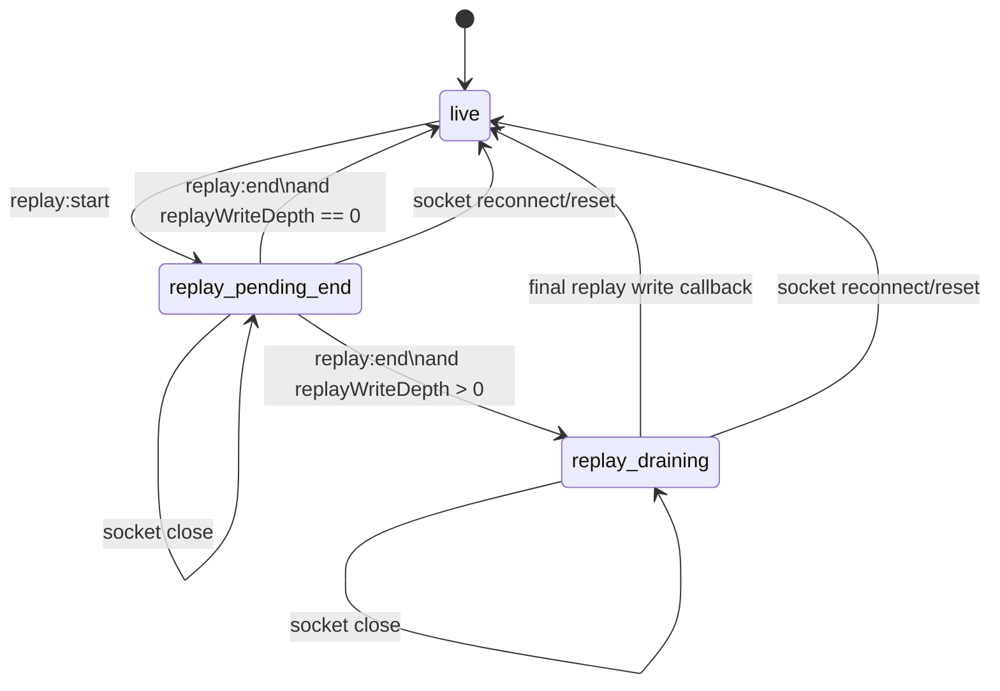
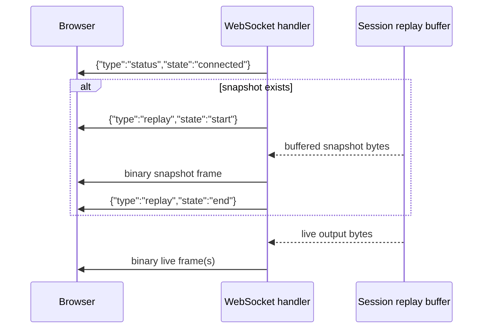

# Workspace REST and Terminal WebSocket API

Core REST endpoints and the terminal WebSocket protocol for workspaces, sessions, SSH config, split
previews, and pane URL opening. Startup, configuration, and operational assumptions live in
[Behavior specification](../behavior.md); security boundaries live in
[Authentication](../security/auth.md) and
[Split preview and URL-open security](../security/preview-and-urls.md).

## Request guard and mutation atomicity

Every API route applies the
[shared browser request guard](../security/auth.md#shared-browser-request-guard) before
authentication or handler side effects, including `GET`, mutations, and `OPTIONS`. Another loopback
port or hostname is refused with `403`; browser requests without `Origin` require a matching
`Referer` and consistent Fetch Metadata. Requests without browser headers remain supported for CLI
clients. Vite uses its same-origin proxy preserving `Host` and `Origin`; direct cross-port browser
requests to the backend are refused.

### A mutation that fails changes nothing

Every route that changes config persists it before answering, and when persistence fails **the
config panemux is still running is the config the error says was not saved**:

- Each config mutation takes a snapshot and restores it if persistence fails.
- Routes that **destroy** sessions (`DELETE /api/sessions/{id}`, `DELETE /api/workspaces/{id}`)
  persist the config change first and tear down sessions only once the write succeeds. A `500`
  leaves the pane working and retryable.
- Routes that **create** sessions (`POST /api/workspaces`) close and unregister any sessions already
  created if a later pane or the write itself fails.
- `POST /api/sessions/{id}/restart` creates the replacement session before touching anything, so a
  failure leaves the existing session registered and servable.
- Validation failures (`400`, `422`) and unknown IDs (`404`) never reach the mutation.

## Layout, workspace, and display endpoints

### `GET /api/layout`

Returns the current layout tree as JSON.

Every response layout node carries `direction` and `children`. Missing `direction` is normalized;
missing `children` becomes `[]`. A root `pane` with no children becomes its single layout child and
is validated like any other pane (missing type or an undefined SSH connection fails startup with the
equivalent child-pane error). Normalization does not repair invalid values such as `direction`.

A node containing both `pane` and `children` is preserved as written, including the root `pane` in
the response and frontend schema, without prepending or rescaling siblings. Zod requires `direction`
and `children` for the whole workspaces response so undeclared fields are not stripped on later
saves. The normalized shape is persisted on the next layout save, never rewritten on read.

### `PUT /api/layout`

Accepts a layout JSON document, validates it, updates in-memory state, and persists it when possible.

- `400`: invalid JSON
- `422`: structurally invalid layout
- `200`: accepted and returned

The request is normalized, then `~/` paths are expanded, then validated, stored, and echoed,
matching config load order. Expansion follows normalization so a relocated root pane's `cwd` is
expanded too. The echoed response has normalized `direction`/`children` and passes the frontend
schema. The same rules apply to `PUT /api/workspaces/{id}/layout`.

### `GET /api/workspaces`

Returns the active workspace ID, `tab_position`, `vertical_bar_width`, and all workspace layouts.

### `PUT /api/workspaces/tab-position`

Accepts `{ "tab_position": "top" | "bottom" | "left" | "right" }`, validates it, persists the
workspace config, and returns the updated workspace response.

- `400`: invalid JSON
- `422`: invalid tab position
- `500`: unable to save the config
- `200`: updated and returned

### `PUT /api/workspaces/vertical-bar-width`

Accepts `{ "vertical_bar_width": <int> }`, validates the shared vertical workspace-bar width in
pixels, persists the workspace config, and returns the updated workspace response.

- `400`: invalid JSON
- `422`: invalid width
- `500`: unable to save the config
- `200`: updated and returned

### `GET /api/display`

Returns display preferences such as header/status-bar visibility, and `task_dashboard_shortcut`: the
effective task dashboard shortcut letter, upper-cased (`S` when config does not set one).

## Session, preview, and URL-open endpoints

### `GET /api/sessions`

Returns a list of active sessions with `id`, `type`, `title`, and `state`. Task dashboard temporary
attaches ([`POST /api/tasks/attach`](tasks.md#post-apitasksattach)) and host terminals
([`POST /api/hosts/terminal`](tasks.md#post-apihoststerminal)) are not listed.

### `POST /api/sessions`

Creates a session from a `PaneConfig` payload, provided the pane ID does not already exist.

- `400`: invalid JSON
- `409`: duplicate session ID
- `422`: invalid pane config
- `201`: session created

Used by the frontend when splitting a pane or using pane-header quick-add buttons to create a
default local pane to the right or below. It remains a narrow pane-lifecycle API, not a general
provisioning layer.

### `DELETE /api/sessions/{id}`

Removes the pane from the layout, collapses redundant parent splits, normalizes sibling sizes,
persists the result, then closes the session and returns `204`.

- `404`: no session registered for `id`
- `500`: layout could not be saved; the session stays registered and open and the pane remains in
  the layout for retry ([A mutation that fails changes nothing](#a-mutation-that-fails-changes-nothing))
- `204`: pane removed and session closed

### `POST /api/sessions/{id}/restart`

Recreates the session for an existing pane from its config (for example after losing an SSH
connection). The replacement session is created first; the old session is removed and swapped only
once the new one starts successfully.

- `404`: no pane config exists for `id`
- `409`: a restart for this `id` is already in progress (concurrent restarts for the same pane are
  serialized)
- `500`: session creation failed (for example SSH dial/handshake error); the prior session, if any,
  remains registered and servable so `/ws/{id}` and `/git-info` keep working until a later restart
  succeeds
- `200`: new session replaced the old one (or created fresh if none existed)

SSH transport dialing retries transient failures (including DNS errors) a bounded number of times
with short backoff. Only TCP/`ProxyJump`/`ProxyCommand` connection setup is retried, never handshake
or authentication failure. One wall-clock deadline covers the entire `ProxyJump` chain, and each
attempt's timeout shrinks to the remaining budget. Each SSH handshake (version exchange, key
exchange, authentication) gets at most `30 s` and no more than the remaining dial budget—never a
fresh window per hop—enforced even over `ProxyJump` channels and `ProxyCommand` pipes; a timed-out
handshake returns `500`.

### `POST /api/sessions/{id}/open-url`

Accepts `{ "url": "<http(s) URL>" }` and prepares the panemux host for a URL the browser is about to
open on that pane's behalf. The frontend opens the tab; this endpoint only publishes the URL's
loopback callback port on the panemux host.

- `400`: invalid JSON body
- `404`: no session exists for `id`
- `409`: loopback port cannot be bound on the panemux host (another pane already forwards it or an
  unrelated local process holds it); reported rather than rewritten because OAuth providers require
  exact `redirect_uri` matching
- `422`: URL missing, unparseable, or scheme other than `http`/`https`
- `500`: forward could not be established for another reason
- `200`: request understood

```json
{ "url": "https://example.com/auth?...", "forwarded": true, "port": 51789 }
```

`forwarded` is `false`, with a human-readable `reason` and no `port`, when nothing needed
forwarding (no loopback callback port, or a `local`/`tmux` pane already running on the panemux host).

### `POST /api/sessions/{id}/preview`

Accepts `{ "path": "<path as shown in terminal>" }`, resolves it from the session's working
directory and agent worktrees, and registers the HTML or Markdown file for the
[split preview](../behavior/preview.md). For `ssh`/`ssh_tmux` sessions (panes or task attaches), the
path is resolved on and read from the SSH host.

For `ssh`/`ssh_tmux` sessions, accepts `{ "url": "<localhost URL>" }` instead, relaying the host's
address and port to a dedicated port on `127.0.0.1` of the panemux host
([Localhost URLs of an SSH host](../behavior/preview.md#localhost-urls-of-an-ssh-host)).

- `400`: invalid JSON; path not `.html`/`.htm`/`.md`/`.markdown`; URL not `http`/`https` on
  `localhost`/`127.0.0.1`/`[::1]`; URL for a panemux-host session; or `ssh`/`ssh_tmux` session with
  no SSH connection
- `403`: file outside the session's working directory and agent worktrees (absolute path elsewhere,
  escaping `../`, or escaping symlink; reason names allowed directories)
- `404`: no session exists for `id`, or no file exists at the path (reason names searched locations)
- `413`: file larger than `10 MiB`
- `422`: working directory and agent worktrees are all unknown
- `502`: SSH host unreachable, offers no SFTP subsystem for a path, or nothing answers at the URL
- `200`: preview ready or candidates to choose from

Errors carry their reason as plain text. Ready file:

```json
{ "status": "ready", "kind": "file", "url": "/preview/<token>/mockups/index.html", "path": "/workspace/user/project/mockups/index.html", "host": "" }
```

Relayed URL (`path` holds the clicked URL):

```json
{ "status": "ready", "kind": "url", "url": "http://127.0.0.1:<relay port>/app", "path": "http://localhost:5173/app", "host": "devbox" }
```

Multiple relative-path matches (absolute paths in search order; the chosen path is resent as `path`):

```json
{ "status": "choose", "candidates": ["/workspace/user/project/docs/design.md", "/workspace/user/project-wt/docs/design.md"], "host": "" }
```

`host` is `""` for the panemux host, otherwise the session's `ssh_connections` name.

### `GET /preview/{token}/*`

Serves a registered preview and files under its root. Intentionally outside `/api` and its request
guard because the framed page runs in an opaque origin and all subresource requests are cross-site;
the random token grants access. Missing tokens/files, directories, `..`, and escaping paths or
symlinks return `404`; HTML or Markdown files over `10 MiB` return `413`. Markdown is returned
rendered as HTML. Isolation headers and policies live in
[Split preview and URL-open security](../security/preview-and-urls.md).

## SSH configuration endpoints

### `GET /api/ssh-connections`

Returns a sorted list of all known SSH connection names—the union of `ssh_connections` (YAML) and
non-wildcard hosts from `~/.ssh/config`, deduplicated with YAML taking precedence:

```json
{ "names": ["bastion", "prod-web"] }
```

### `GET /api/ssh-config/hosts`

Returns all non-wildcard hosts from `~/.ssh/config` with full details (`port` and `identity_file`
omitted when unset):

- `500`: unable to read `~/.ssh/config`
- `200`: host list

```json
{
  "hosts": [
    { "name": "bastion", "hostname": "bastion.example.com", "user": "ops", "port": 22, "identity_file": "~/.ssh/id_ed25519" }
  ]
}
```

### `POST /api/ssh-config/hosts`

Appends a new `Host` block to `~/.ssh/config`:

```json
{ "name": "my-server", "hostname": "192.168.1.5", "user": "deploy", "port": 22, "identity_file": "~/.ssh/id_ed25519" }
```

- `400`: invalid JSON
- `409`: host with the same name already exists in `~/.ssh/config`
- `422`: validation error (missing `name`/`hostname`/`user`, invalid `name` characters, control
  character such as line break in `hostname`/`user`/`identity_file`, port out of range)
- `500`: unable to read or write `~/.ssh/config`
- `201`: host appended

`name` must match `^[a-zA-Z0-9_.\-]+$`. `hostname`, `user`, and `identity_file` must not contain any
control character because each is written on one line ([SSH `ProxyCommand`](../security/process-and-ssh.md#ssh-proxycommand)).
`port` defaults to `0` (omitted from the block); `identity_file` is optional.

### `/api/config/ssh-connections`

Lists and edits `ssh_connections` in `config.yaml` (dashboard-collected hosts usable by panes too;
distinct from `~/.ssh/config`). All four routes reject cross-site requests with `403` and persist
via whole-file atomic write; write failure returns `500` `failed to save ssh_connections` leaving
the running config unchanged. Error bodies are `{"error": "…"}` naming a field, never its value.

Entry shape (`host`, `user`, `port`, `key_file`, `known_hosts_file` omitted when unset; password
never returned):

```json
{
  "name": "build-box", "host": "build.example.com", "user": "deploy", "port": 2222,
  "key_file": "/home/deploy/.ssh/id_ed25519", "known_hosts_file": "/home/deploy/.ssh/known_hosts",
  "has_password": true, "in_ssh_config": false, "panes": ["build"]
}
```

`in_ssh_config` indicates whether `~/.ssh/config` has a matching `Host` block supplying unset
fields; `panes` lists the IDs of `ssh`/`ssh_tmux` panes across all workspaces referencing the entry.

- `GET /api/config/ssh-connections` — `200` `{"connections": [entry, …]}` sorted by name.
- `POST /api/config/ssh-connections` — adds an entry (`name` plus optional `host`, `user`, `port`,
  `key_file`, `known_hosts_file`, `password`). `201` with entry; `400` invalid JSON or unknown
  field; `409` duplicate name; `422` missing/malformed name
  ([connection-key rule](../behavior/ssh.md#defining-connections-in-ssh_connections)),
  `clear_password`, or field error below.
- `PUT /api/config/ssh-connections/{name}` — replaces fields with body (omitted fields removed,
  except empty/absent `password` keeps the saved password, non-empty replaces it, and
  `clear_password: true` clears it). `name`, if sent, must match `{name}` (no rename). `200` with
  entry; `404` unknown name; `400`/`422` as for `POST`, plus `422` if `password` and
  `clear_password` are both set. Drops the host's pooled dashboard connection and discards any
  in-flight dial.
- `DELETE /api/config/ssh-connections/{name}` — `204`; `404` unknown name; `409` if a pane or
  another dashboard host would stop resolving without it (including via `~/.ssh/config`
  `ProxyJump`), naming them.

`{name}` is URL-escaped preserving Unicode and plus signs; keys follow config-load validation.
Field errors (`422`): `port` outside `1–65535` (`0`/absent means unset); control character in
`host`/`user`/`key_file`/`known_hosts_file`; `key_file`/`known_hosts_file` neither absolute nor
`~/`-relative (`~/` expanded on save); or missing `host` with no readable `~/.ssh/config` `Host`
block.

## Related endpoint groups

- Task and host terminal REST routes plus `/ws/tasks/events`: [Task API](tasks.md).
- Agent Board REST routes, `/api/session-token`, and `/ws/board/command`:
  [Agent Board API](agent-board.md).
- Manual and global automatic agmsg host tool routes (`GET`/`POST /api/hosts/agmsg`,
  `POST /api/hosts/agmsg/auto-update`): [Host tool management](../behavior/host-tools.md).

## WebSocket browser connection policy

All WebSockets apply the
[shared browser request guard](../security/auth.md#shared-browser-request-guard) before upgrading:

- Another hostname or port in `Origin` returns `403`, including another loopback port without Fetch
  Metadata.
- `Sec-Fetch-Site: same-site` and `cross-site` are refused.
- Origin-free CLI requests without browser headers remain supported; Origin-free browser requests
  require a matching `Referer` and consistent Fetch Metadata.
- TLS termination is supported by comparing hostname and effective port rather than transport
  scheme (another scheme on the same explicit port remains an accepted limitation).
- Development HTTP and WS proxies preserve `Host` and `Origin`.

## Terminal WebSocket protocol

Endpoint: `GET /ws/{sessionID}`

### Connection and frames

- `404` if the session ID does not exist (limited to never-created IDs; a failed `/restart` leaves
  the prior session registered).
- Initial text frame: `{"type":"status","state":"connected"}`.
- On reconnect with buffered output, backend emits `{"type":"replay","state":"start"}`, sends the
  recent per-session output buffer as a binary frame, then emits `{"type":"replay","state":"end"}`
  before live output; with no buffered output, live output starts immediately.
- Binary frames carry raw terminal input (browser → server) and output (server → browser).
- Text frames from browser carry JSON control messages; zero-dimension resizes and invalid JSON
  control frames are ignored rather than terminating the session.

```json
{ "type": "resize", "cols": 120, "rows": 40 }
```

```json
{ "type": "replay", "state": "start" }
```

```json
{ "type": "replay", "state": "end" }
```

When the backend session reaches EOF, the handler emits:

```json
{ "type": "status", "state": "exited" }
```

### Replay state machine

| State | Entry condition | Allowed events | Exit condition | Frontend effect |
|---|---|---|---|---|
| `live` | initial steady state, or replay fully completed | live binary output, `replay:start`, socket close, socket reconnect | `replay:start` or socket teardown | `disableStdin = false`; terminal input and xterm replies flow normally |
| `replay_pending_end` | `replay:start` received | replay binary output, `replay:end`, `replay:end` write failure, socket close, socket reconnect | `replay:end` or socket teardown | `disableStdin = true`; replay bytes may still arrive |
| `replay_draining` | `replay:end` received while replay writes remain in flight | replay write callback completion, socket close, socket reconnect | last replay write callback completes | `disableStdin = true`; scheduled writes may still trigger xterm side effects |

Every reconnect resets to `live` before processing new frames so a socket close or replay-control
write failure cannot leave stdin suppressed.





### Alloy model

- The replay state machine is mirrored in [replay_state.als](../models/replay_state.als) with states
  `Live`, `ReplayPendingEnd`, and `ReplayDraining`.
- Verified invariants:
  - `Live` never leaves `disableStdin` enabled.
  - Replay states always keep `disableStdin` enabled.
  - `ReplayDraining` is only reachable while replay writes remain queued.
  - `ReplayEndWriteFail` leaves the model in `ReplayPendingEnd` until reconnect.
  - `SocketClose` does not falsely restore `Live` while replay is incomplete.
  - `Reconnect` always resets the model to a clean `Live` state.
  - Stale replay suppression cannot survive in `Live`.
- Changes that introduce or alter observable state transitions should update the corresponding Alloy
  model in `docs/models/` in the same change (CI runs Alloy checks only when `docs/models/` changes;
  inspect counterexamples locally by running the bundled `check` commands in Alloy).
