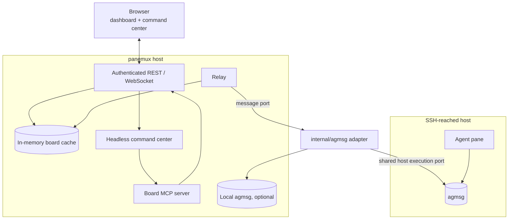
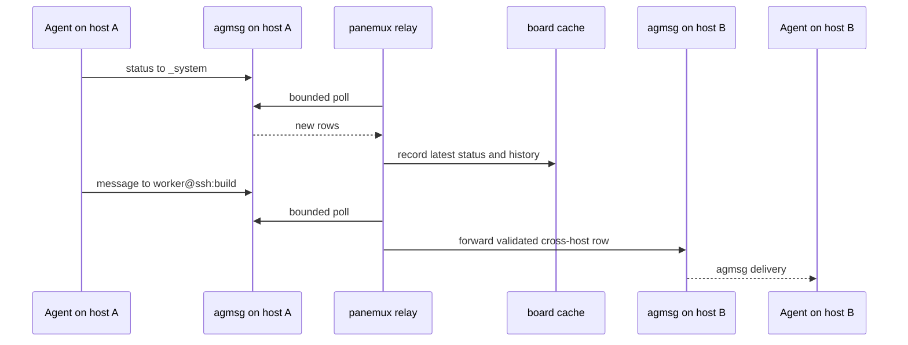

# Agent Board Architecture, Detection, and Cross-Host Relay

Agent Board adds self-reported agent status, cross-host messaging via agmsg, a read-only dashboard,
and an optional headless Command Center. It is additive: missing or unreachable agmsg disables board
features on that host without affecting terminal panes, and untested agmsg versions warn without
blocking startup. Wire contracts live in [Agent Board API](../../api/agent-board.md); UI lives in
[Agent Board UI](../../ui/agent-board.md); security rules live in
[Agent Board security](../../security/agent-board.md); historical rationale lives in
[Agent Board decisions](../../decisions/agent-board.md).

## Architecture and ownership



Panemux runs on one host, reaching itself and `ssh_connections` keys through the shared host
execution port (even without panes on a host), enforcing the
[shared connection-key rule](../workspace/sessions.md#defining-connections-in-ssh_connections) so
every configured host can appear in a `BoardID`. Panemux never installs or runs itself remotely.
Only `internal/agmsg` invokes agmsg scripts (`internal/board` depends on `MessageClient` and
`Participation` ports), and panemux never reads or modifies agmsg's database or team files.

- **Panemux owns**: configuration, authentication, host polling, cross-host routing, relay cursors,
  in-memory cache, dashboard, Command Center, and the single agmsg script adapter.
- **agmsg owns**: team membership, identities, durable message storage, delivery, and script
  behavior.
- **State & persistence**: `Relay` is the sole writer to `BoardCache` (broadcasts send immediately
  but appear in history only once polled back). Dashboard reads never block on local processes or
  SSH. Cache sequences are panemux-local and unrelated to agmsg's opaque host-local row IDs. Panemux
  persists only local private (`0600`) operational metadata—one relay cursor per host/team and the
  Command Center session (atomically replaced) plus append-only JSONL command history (skips any
  crash-truncated line)—never a second message store.
- **Package layout**: `internal/board` (ports, relay, cache, cursors, participation snapshots,
  own-send ledger), `internal/agmsg` (script adapter, paths, versions, parsing, availability, agent
  type mapping), `internal/host` & `internal/hostexec` (host identity, shared execution pool),
  `internal/session` (terminal sessions, detection, SSH command transport), `internal/api`/`ws`/
  `server` (authenticated surfaces), `internal/commandcenter`, `internal/boardmcp`.

| Resource | Panemux host | SSH-reached host |
|---|---:|---:|
| panemux server and browser API | yes | never |
| board cache, cursors, command history | yes | never |
| agmsg | optional | installed separately by operator |
| agent process | optional | yes |

## Configuration

```yaml
server:
  host: "127.0.0.1"
  port: 8080
  auth_token: ""   # empty: generate and persist a private token

command_center:
  enabled: true     # default: false; independent of agmsg availability

agent_board:
  enabled: false # opt in for the whole instance
  # mode: monitor # deprecated: validated, warned about once per load, and ignored
  team: "panemux"
  agmsg_auto_update: false # update older installed copies on all hosts
```

- Enablement and `team` are instance-wide (no pane or host overrides; Pane Settings exposes no board
  controls). Removed pane `agent_board` blocks and `agent_board.agmsg_path` produce migration
  errors; each host uses `~/.agents/skills/agmsg`.
- `agent_board.mode` accepts `monitor`, `turn`, `both`, `off`, or empty for one release, warns once
  per load, has no runtime effect, and is omitted on save (loading without it keeps the in-memory
  API default `monitor` without warning).
- `command_center` is a sibling of `agent_board` and works without enabling Agent Board or local
  agmsg.
- An SSH pane participates only when its `connection` exactly matches an `ssh_connections` key; a
  `~/.ssh/config`-only pane warns at startup and is excluded (add a name-only `ssh_connections`
  entry to include it).
- `_system` is reserved and rejected as a pane ID or team; external processes can still pass it to
  agmsg, so relay validation relies on the own-send ledger rather than the name alone.

## Pane detection and bootstrap

With `agent_board.enabled: true`, the watcher detects agents in configured panes whose hosts resolve
using the registry's Board rules (`claude`, `codex`, `cursor`, `gemini`, `grok-build`, `opencode`;
explicit-only and desktop agents are not guessed).

- **No PTY writes**: the watcher never writes to a pane's PTY, never joins agents, never claims
  identities, and never sends onboarding instructions. `instructed` stays `false` for API
  compatibility. `board-bootstrap-state.json` is neither read, written, nor deleted.
- **Availability checks**: address validation precedes detection. After two consecutive polls detect
  the same session, host availability is checked via the shared execution port and remembered for
  that session (discarded on session replacement, host change, or pane removal). Failed discovery or
  presence probes retry on later polls; managed tool-update pauses are silent and retryable; SSH
  dial failures share the task board's `60 s` cooldown and manual reconnect. Warnings emit once per
  `(pane, session, failure kind)` until recovery (path discovery and presence probes track separate
  streaks).
- **Live eligibility**: follows live config (new panes detected on next poll; removal immediately
  revokes relay addresses). Self-reports can outlive a session and do not grant routing authority.

## Status self-report and message flow

Status is an ordinary agmsg message addressed to unqualified `_system` whose JSON body includes the
mandatory discriminator `"kind": "board_status"` (JSON to `_system` without that exact value stays
an ordinary message):

```json
{
  "kind": "board_status",
  "state": "working",
  "cwd": "/workspace/user/project",
  "branch": "feature/x",
  "repo": "owner/repo",
  "pr_url": "https://github.com/owner/repo/pull/123",
  "last_tool": "Edit internal/api/handler.go",
  "summary": "Fixing the failing relay tests"
}
```

Agents report their own `cwd`, Git, PR, and `summary` cooperatively; panemux neither infers missing
summaries nor enforces cadence.



The relay stores latest status per `name@BoardID` in the configured team (retaining source host/team
in bounded history with `is_status: true`, filtered out of conversation history) and projects
matching reports onto pane-ID keys for compatibility ([identity entries](../../api/agent-board.md#identity-entries)).

## Cross-host relay

agmsg is host-local; panemux polls `local` and each `ssh:<ssh_connections key>` (`BoardID()`, where
`ssh:local` is distinct from `local`) for `agent_board.team` without requiring panes.

### Addresses, forwarding, and sender validation

- **Syntax**: agent names match `[A-Za-z0-9_.-]+`; SSH keys match `[\p{L}\p{M}\p{N}_.+-]+`
  (preserving spelling without normalization); qualified addresses are `<name>@local` or
  `<name>@ssh:<key>`. Empty parts, extra `@`/`:`, shell syntax, unknown hosts, and qualified
  `_system` are rejected before history or forwarding.
- **Routing**:
  - Unqualified ordinary recipients stay local on the source host.
  - Qualified recipients forward to the target host with `to=<name>` and
    `from=<original name>@<source BoardID>` (even when targeting the source host), requiring neither
    a pane nor a roster entry.
  - Compatibility: an unqualified recipient matching a configured pane on another host forwards
    there with `from=<original name>@<source BoardID>`; receivers reply to that qualified sender so
    copy rejection survives pane removal or movement without a forwarding ledger.
  - Unqualified `_system` targets panemux on the source host.
- **Sender validation**: valid unqualified names read from host `H` via `api.sh` are accepted as
  originating at `H` without roster lookup. Every `from` containing `@` (including forwarded copies),
  unqualified pane IDs owned by another host, and wrong-team rows are rejected before affecting
  history, status, or forwarding.
- **`_system` own-send ledger**: `from == "_system"` requires consuming one entry from the
  short-lived multiset ledger keyed by `(destination host, team, unqualified recipient, body hash)`
  (preserving identical repeated broadcasts; failed sends cancel one entry; unmatched/expired rows
  rejected; matched own sends recorded without re-forwarding). Broadcast validates all recipients
  before sending any and records destination-visible unqualified recipients in the ledger.

### Plugin send and reply contract

Send cross-host messages with agmsg's public `send.sh` using your unqualified sender name and
`--force` (required because remote identities are not in the local roster); reply verbatim to the
received `from` (e.g., `worker@ssh:build`):

```sh
bash ~/.agents/skills/agmsg/scripts/send.sh panemux worker orch@local 'ready for review' --force
```

For option-like bodies, pass `--body -` on stdin so `send.sh` never parses text as flags:

```sh
printf '%s' '--force is message text' |
  bash ~/.agents/skills/agmsg/scripts/send.sh panemux worker orch@local --body - --force
```

Panemux neither registers proxy roster entries nor distributes a send wrapper. Source-host
attribution is not same-user authentication: any same-user process on `H` can impersonate a name in
`H`'s agmsg installation, and receiving a message never authorizes work or bypasses approval rules.

### Polling, startup backfill, and connection handling

- Each poll reads a bounded newest window, selects rows after its opaque cursor, validates and
  records originals, forwards eligible rows, and advances the source cursor even after a forwarding
  failure (atomic snapshot write only when cursors changed). Managed tool-update pauses leave the
  source batch retryable before cache/ledger/cursor mutations; lease admission checks eligibility
  first without consuming the own-send ledger so rejected rows never block valid rows.
- On startup, a larger bounded backfill per host/team repopulates recent status and history (rows
  outside the backfill window are not recovered).
- SSH dials for polling and bootstrap start in the background (returning connecting state rather
  than consuming the pass timeout); repeated identical poll errors log only on state transitions.
  Operator sends wait for an establishing SSH connection within the send context.

## Known limitations

- **Availability & recovery**: failed SSH dials back off `60 s` (in-use drops redial immediately;
  host-menu Reconnect clears cooldown); confirmed missing agmsg caches as absent until a managed
  installer attempt; updates pause only panemux calls (restart agents after Install/Update; failed
  installers may need manual recovery); `~/.ssh/config`-only panes are excluded unless listed in
  `ssh_connections`; cache is memory-only; broadcasts appear in dashboard history up to one poll
  interval later; current UI lists only detected agents or reporting configured panes.
- **Delivery guarantees**: cross-host forwarding is best-effort (failed sends advance cursor and
  never retry); crash between forward and cursor persist can duplicate; bursts exceeding the poll
  window drop oldest overflow rows; no message claim/lease semantics; same-user impersonation is
  possible on a host; panemux is always in the data path (no peer-to-peer host connections).
- **Bootstrap & status**: detection does not register participation or isolate same-project
  identities; a quoted prompt containing a headless exclude token as a standalone whitespace token
  can be misclassified as headless; status is cooperative with no independent Board liveness signal;
  token/account usage is out of scope for Agent Board.
- **External dependency**: NUL-containing bodies (`U+0000`) are rejected by panemux's shell-variable
  wrapper before execution (never silently altered; broadcast returns error with no delivery; relay
  logs and keeps original under best-effort cursor). Pinned agmsg v1.7.1
  (`f5898f49eb3d3c079c446dab4bca715b832da313`) and panemux's command-substitution wrapper normalize
  trailing newlines (`TestAgmsgContract_TrailingNewlinesAreNormalized`). agmsg promises
  compatibility only for its read API, not write scripts; untested versions warn and continue.
- **Command center**: single conversation per panemux instance (no per-workspace or concurrent
  sessions); each query spawns a fresh `claude -p` process.
- **Detection cost**: with Agent Board enabled, every eligible configured pane polls every `5 s`
  (local `ps`, tmux queries, remote SSH detection commands, unshared across panes), growing linearly
  with pane count; availability probes wait for two consecutive detections and stop after
  confirmation for that pane session.
