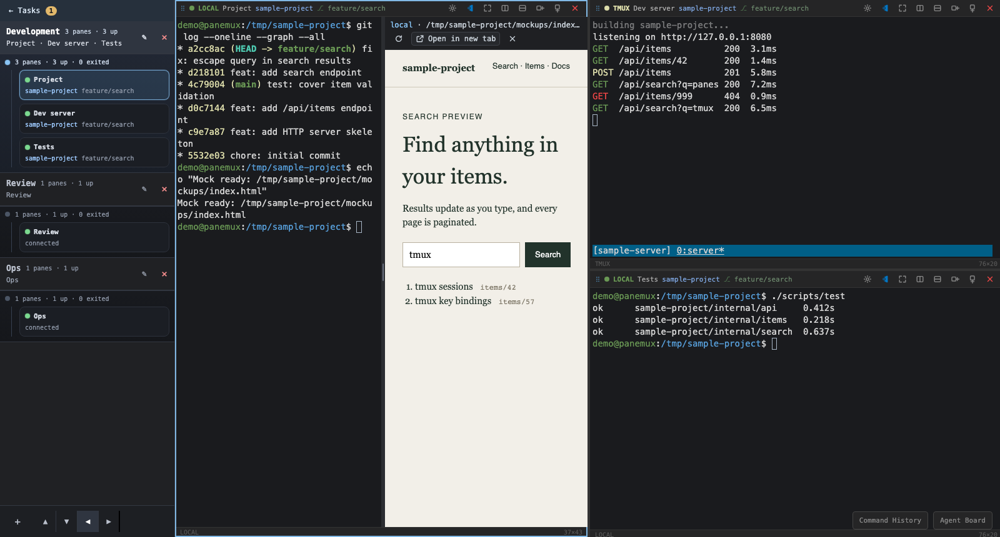

# Split Preview and Pane URL Opening

Runtime contracts for previewing local/SSH HTML, Markdown, and localhost pages beside a terminal,
and for opening URLs and forwarding loopback OAuth callbacks from panes. REST contracts live in
[Workspace API](../../api/workspace.md); presentation lives in
[Workspace UI](../../ui/workspace.md); isolation and command-safety boundaries live in
[Split preview and URL-open security](../../security/preview-and-urls.md).

## Split preview

A workspace pane and the task dashboard's Type in pane popup can display an HTML/Markdown file or a
localhost page on the right of the terminal (`50:50` split).

### Opening a file

- `.html`, `.htm`, `.md`, and `.markdown` paths (any letter case) printed in `local`, `tmux`, `ssh`,
  `ssh_tmux` panes and any task's Type in pane popup become links: absolute, `~/…` (current user's
  home only, not `~user/…`), `./`/`../`, and bare relative paths; trailing `:12` or sentence
  punctuation is excluded, and paths inside URLs belong to the URL.
- Clicking calls [`POST /api/sessions/{id}/preview`](../../api/workspace.md#post-apisessionsidpreview),
  resolving relative paths against the shell's working directory first, then each active coding
  agent worktree. One match opens; multiple matches prompt to choose (deduplicated by resolved file);
  zero matches or disallowed paths show the reason naming searched/allowed directories.
- Files inside the working directories open regardless of prefix symlinks (`/tmp` vs `/private/tmp`)
  or case-insensitive filesystem spelling and are served from the innermost working directory holding
  them (**root**), so sibling assets and relative symlinks staying inside work while escaping or
  absolute-target symlinks inside a working directory are refused (`403`).
- Explicit paths outside the working directories—absolute paths, `~/…` paths (expanded via the
  server's home directory), and `../` paths leaving a working directory—also open when they resolve
  to a regular HTML or Markdown file, including when no working directory is known (relative paths
  still require a known working directory). If an outside symlink resolves inside a working
  directory, that innermost working directory becomes the root; otherwise the resolved file's parent
  directory becomes the root. When that parent is `/`, the home directory, or `/tmp` (or
  `os.TempDir()`), the preview is restricted to **single-file serving** so sibling files and
  subdirectories return `404` (a pane whose own working directory is `~` or `/tmp` keeps normal
  working-directory serving). The HTML/Markdown file itself is capped at **10 MiB** (sibling assets
  are unbounded).

### Opening a localhost URL

`http`/`https` URLs targeting `localhost`, `127.x.x.x`, or `[::1]` reach the preview through the
pane's single URL opener in three ways:

1. **Printed link** (clicked): opens in preview immediately while connected (no approval strip).
2. **Browser shim**: shows the approval strip with **Preview**, **Open** (new tab + callback
   forward), and **Ignore**.
3. **OSC 8 hyperlink** (clicked): shows the same strip labeled **This link goes to** naming the
   target URL.

Each request acts at most once and removes the strip; clicking the same printed URL clears any
matching pending strip. Requests are live events only (replayed scrollback never re-raises them).
Non-loopback URLs open in a browser tab without Preview. While the terminal is disconnected, Preview
is unavailable (strips offer Open/Ignore only; clicked localhost links open in a tab). In Type in
pane popups, Retry/Reconnect replaces the attach and drops pending requests.

Framed localhost pages run in the dev server's own origin inside a loopback-restricted wrapper
(blocking redirects to external sites while allowing moves between `localhost` and `127.0.0.1`).
`[::1]` URLs are framed via `localhost` (sharing `localhost` cookies/storage; **Open in new tab**
uses `[::1]`). A note under the header always warns that pages refusing framing (`X-Frame-Options`/
`frame-ancestors`) render blank and that hot reload, sign-in, or storage can differ from a normal
tab.

### Panes on an SSH host

- Clicking a file path in an `ssh`/`ssh_tmux` pane or remote task popup resolves against the remote
  shell CWD and agent worktrees using the pane/attach's **original** SSH connection parameters
  (editing `ssh_connections` later does not redirect existing panes or previews).
- Files are read exclusively over the SSH server's **SFTP subsystem** (no fallback if SFTP is
  absent), over a preview-owned SSH connection independent of the pane session so independent tabs
  outlive pane/popup/session closure.
- Symlinks on the remote host are resolved component-by-component over SFTP. Leading `~/…` paths
  are expanded against the remote home reported by SFTP `Getwd()` (no shell command runs). Files
  inside the working directories are served from the innermost working directory holding them, and
  symlinks inside a working directory that escape it are refused (`403`). Explicit outside paths
  (absolute, `~/…`, or `../` leaving a working directory) open even when no working directory is
  known and are served from the resolved file's parent directory—or restricted to single-file serving
  when that parent is `/`, the remote home directory, or `/tmp`—with the same `10 MiB` cap.
- **Liveness**: any arriving SSH traffic proves liveness. Idle connections are pinged after `15 s`;
  unanswered pings (`15 s`), stalled lookups (`15 s` with no incoming bytes), or a lost SFTP
  subsystem close and reconnect on the next request without prematurely killing slow active streams.

### Localhost URLs of an SSH host

- Loopback URLs in `ssh`/`ssh_tmux` panes or remote task popups are relayed to a system-assigned
  port on `127.0.0.1` of the panemux host over the preview-owned SSH connection, preserving path,
  query, and fragment (bare `http://localhost:5173` opens at `/`).
- Separate hosts' identical ports never collide; repeated clicks for the same `(host, target port)`
  reuse the relay; relays bind permanently to their original host/port for server lifetime (even
  after `ssh_connections` edits or pane closure).
- `https://localhost:<port>` keeps `localhost` in the relayed URL so TLS passes through with SNI/
  certificate validation intact (`https://[::1]` relays as `127.0.0.1`, whose cert won't match).
- **Accepted relay caveats**: the page sees the relay address (hardcoded `http://localhost:5173/…`
  links or fixed-port HMR clients hit the panemux host instead of the SSH host), and relayed pages
  share `127.0.0.1` cookies with each other.
- While connected, clicking a printed localhost link opens the relayed preview without creating a
  same-port forward; when disconnected, workspace panes open a tab with a same-port forward while
  task popups open a tab without forwarding. Use the strip's **Open** in a workspace pane when an
  OAuth callback requires the original port number.

### Rendering, Mermaid diagrams, and lifecycle

- **HTML**: served as written with scripts and relative sibling assets.
- **Markdown**: rendered as GitHub-flavored Markdown (tables, task lists, strikethrough, autolinks)
  with raw HTML omitted; relative links to other `.md`/`.html` files open inside the preview. Only
  documents containing a `mermaid` fenced block load the bundled offline Mermaid runtime (pinned in
  `frontend/package-lock.json`; syntax may differ from GitHub's).
- **Mermaid limits & behavior**: first `10` blocks attempted, max `20,000` UTF-16 code units per
  diagram, `50,000` total per document (including rejected source), `100` edges where supported
  (input bounds, not CPU deadlines). YAML frontmatter, `%%{…}%%` directives, HTML labels, click
  handlers, external icon packs, and CSS animations are rejected/unsupported. Image shapes may
  trigger external fetches during live-DOM measurement before final SVG strips image elements (a
  decode failure shows an error and source for that block). Each block retains **Show source**;
  errors isolate per block; MathJax, GeoJSON/TopoJSON, and ASCII STL remain raw code blocks.
- **Divider & terminal continuity**: starts `50:50`, bounded `20%–80%` with `160 px` minimum per
  side (narrow panes tighten range, e.g. `450 px` → `36%–63%`, or hold `50:50` if impossible);
  Left/Right keys step `5%`, double-click resets `50:50`; saved per pane/task in `localStorage`.
  Terminal PTY resizes with width and keeps input/IME/scrollback. While the sandboxed preview frame
  has focus, keys go to the page and panemux shortcuts pause until focus returns (clicking outside or
  reloading) with a status note under the header.
- **Lifetime**: in-pane/in-popup previews hide when the terminal disconnects or exits and remain
  hidden across reconnects until clicked again; **Open in new tab** pages and SSH relays keep
  working until server shutdown.

## Opening URLs from a pane

CLI login flows (`claude` MCP OAuth, `gh auth login`, `wrangler login`, `gcloud auth login`) listen
on loopback and redirect to `http://localhost:<port>/…`. For `ssh`/`ssh_tmux` panes panemux forwards
that callback port back to the panemux host.

### Loopback port forwarding

- Resolves the loopback port from the URL's own loopback host or a `redirect_uri`/`redirect_url`/
  `callback_uri`/`callback_url` query parameter (plain or percent-encoded, case- and `_`/`-`-
  insensitive), republishing the identical port on `127.0.0.1` over the pane's SSH connection.
- Only ports `1024–65535` forward (implicit `80`/`443` never bind). Limits: `8` forwards per pane,
  `32` server-wide, `30`-minute idle expiry, closed on pane delete/restart or server shutdown.
  `local` and `tmux` panes need no forward.
- Host-chip **Type in pane** terminals use the same forwarding and shim interception via their host
  terminal session ID; closing, Retry/Reconnect, or grace-period expiry closes forwards (re-open the
  URL after Reconnect if a CLI is still waiting).
- **Local-browser assumption**: assumes the browser runs on the panemux host; remote browsers cannot
  reach ports bound on panemux's loopback.

### Browser-open interception

With `url_open.browser_shim` enabled (default), `local` and `ssh` panes install a POSIX shell shim
under the host's user cache directory (`~/.cache/panemux/bin` remotely), exported as `$BROWSER` and
prepended to `PATH` as `xdg-open` and `open`. For a single `http`/`https` URL argument, it emits a
private OSC `7373` sequence consumed by the frontend; all other invocations (`xdg-open report.pdf`,
`open -a Safari …`) exec the real opener from the original `PATH`. Install failure (such as a
read-only home) is non-fatal.

- Requests never auto-open; approval strips require explicit operator action, act once, and ignore
  replayed scrollback.
- **Limitations**: local `tmux` panes and pre-existing remote tmux sessions are not intercepted
  (printed links still work). With shim or `PANEMUX_PANE_ID` enabled, `ssh` panes run an explicit
  command (`exec /bin/sh -c '…'` so non-POSIX login shells like `fish`/`tcsh` work) and exec
  `$SHELL -l` for `bash`/`zsh`/`fish` (plain `exec "$SHELL"` otherwise), preserving `cwd`/`shell`.

### New remote tmux sessions

When an `ssh_tmux` pane creates a **new** remote tmux session on **tmux 3.3+** with shim enabled,
panemux passes `BROWSER` and a tmux opt-in marker via `tmux new-session -e` and runs a fixed initial-
pane bootstrap prepending the shim to `PATH` (because tmux overrides `PATH` with the client's),
preserving global tmux env, existing sessions, and `default-shell`/`default-command`. Later windows
inherit `BROWSER` and the marker (not the initial PATH bootstrap); task attaches do not add this
setup. On URL request, the shim enables `allow-passthrough` on **that pane only** and wraps OSC 7373
in tmux DCS passthrough (no server/window option changed; nested tmux unsupported; rc files
overwriting `BROWSER`/`PATH` disable interception). Fresh local and plain SSH panes clear any
inherited opt-in marker.

### Clicked links

Printed links, OSC 8 hyperlinks (`http`/`https` only), and browser-shim requests share one opener:

- **Workspace panes & task popups**: connected printed localhost links open directly in Split
  Preview (relayed on SSH, no callback forward); disconnected printed links open a tab (workspace
  panes prepare callback forwards; task popups never do). Strip **Open** prepares a forward in
  workspace panes and opens without forwarding in task popups. OSC 8 clicks always show the approval
  strip (`This link goes to`).
- **Host-chip Type in pane popups**: never offer **Preview** (even for localhost). Printed URLs open
  directly with callback forwarding; browser-shim and OSC 8 requests show **Open**/**Ignore** and
  prepare forwards on approval. Retry/Reconnect drops pending requests and errors.
- Direct loopback tabs open a blank tab first and navigate once the forward is ready; non-loopback
  URLs open immediately while the callback forward prepares alongside. Forwarding errors surface in
  the pane rather than being silently ignored.
