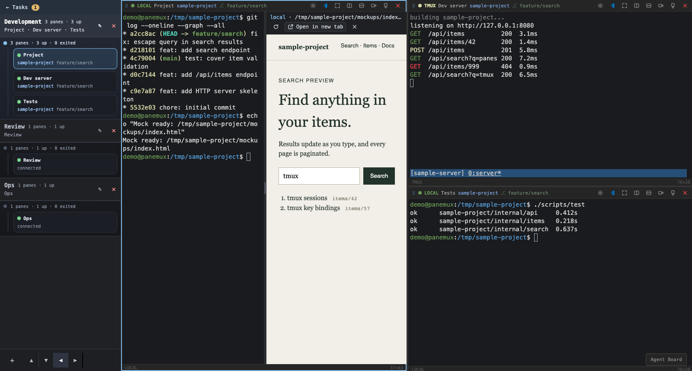

# Behavior: the split preview

> Part of the [behavior specification](../behavior.md). That document carries startup, configuration, and operational assumptions.

## Split Preview

A workspace pane and the task dashboard's Type in pane popup can show an HTML or Markdown file, or a
localhost page, beside their terminal: the terminal on the left, the preview on the right (issues
#385 and #386). It is how a mock or a
design note an agent wrote is checked while the agent is still being instructed in the same terminal.
The isolation that keeps the previewed page away from panemux's own API is in
[security/preview.md](../security/preview.md).

### Opening a file

An HTML or Markdown path printed in the terminal is a link: `.html`, `.htm`, `.md` and `.markdown`,
in any letter case. Absolute paths (`/workspace/user/project/index.html`), dot-relative paths
(`./mockups/index.html`, `../notes.md`) and bare relative paths (`docs/design.md`) are recognized; a
trailing `:12` or sentence punctuation is not part of the path, and a path inside a URL belongs to the
URL. Paths are links in every terminal that has a preview: `local`, `tmux`, `ssh` and `ssh_tmux`
panes, and the Type in pane popup of any task. In an `ssh` or `ssh_tmux` pane, and in the popup of a
task on an SSH host, the file is read from that host ([Panes on an SSH host](#panes-on-an-ssh-host)).

Clicking one opens the split. A relative path is resolved on the server
([`POST /api/sessions/{id}/preview`](rest-api.md#post-apisessionsidpreview)) against:

- the shell's current working directory, then
- each worktree the pane's coding agent is working in (the same candidates the pane header's Git
  information uses).

When exactly one of them holds the file, it opens. When several do — the same relative path in two
worktrees — the preview lists the files found and opens the one chosen. When none does, or the path
cannot be previewed, the preview shows the reason instead, naming the directories looked in. An
absolute path names its own file, which must lie inside one of them.

Only files inside those directories — the shell's working directory and the agent's worktrees — can
be previewed (#359's "path and symlink escape"). An absolute path elsewhere, a `../` that leaves
them, and a symbolic link that leads out of them do not open; the preview shows that the file is
outside them and names the directories allowed. A `../` that stays inside one of them, such as from
a subdirectory of a worktree up to its root, opens. A path is inside a directory however it is
spelled: through a symbolic link in its prefix (macOS's `/tmp` for the `/private/tmp` a working
directory is reported as, or a link to a directory inside it) or, on a case-insensitive filesystem, in another letter case. When the
working directory and the worktrees are all unknown, no path opens.

### Opening a localhost URL

A `localhost`, `127.x.x.x` or `[::1]` `http`/`https` URL in a terminal on the panemux host — a `local`
or `tmux` pane, or the Type in pane popup of a task on the panemux host — opens in the same split
(issue #386), typically a development server the agent started. It reaches the preview three ways,
all handled by the one URL opener the pane already uses
([opening URLs from a pane](url-open.md)):

- **A printed link**, clicked: it opens in the preview at once. Its text is the URL, so the operator
  sees what they click.
- **The browser shim**: a program in the pane opening a browser (`vite --open`, `xdg-open`) shows the
  approval strip with **Preview**, **Open** and **Ignore**. Preview shows the page beside the
  terminal; Open opens it in a tab exactly as before, including the OAuth callback forward;
  Ignore drops it.
- **An OSC 8 hyperlink**, clicked: its target is chosen by the program's output and need not be its
  text, so it shows the same strip, saying **This link goes to** and naming the target.

Each request opens at most once. The strip's buttons act on the request they were shown for and
then remove it, so a second press, or Preview followed by Open, opens nothing more; clicking the same
URL as a link while its request is showing removes the request. A request is a live event: one that
arrives in replayed scrollback after a reconnect is not raised again.

Any other URL — an external site — opens in a tab as before, with no Preview. A localhost URL in an
`ssh` or `ssh_tmux` pane or a remote task names that host's `localhost`; it reaches the preview the
same three ways, through a relay ([Localhost URLs of an SSH host](#localhost-urls-of-an-ssh-host)). While the
terminal is not connected (its WebSocket dropped, or its session ended) the preview cannot open, so
Preview is not offered either: the strip keeps Open and Ignore, and a clicked localhost link opens in
a tab.

The strip is drawn over the terminal side of the split, so while a preview is open its header —
the URL it shows, Reload, Open in new tab and Close — stays in view. In the Type in pane popup a
request belongs to the attach that raised it: Retry or Reconnect replaces the terminal, and a request
still waiting is dropped with it.

The page is framed as its server serves it, in the server's own origin, with its scripts running,
so a development server's modules, hot reload and storage work as they do in a tab. Under the
header the preview says what a frame cannot always show: a page that refuses to be framed
(`X-Frame-Options` or `frame-ancestors`) stays blank, and hot reload, sign-in or storage can behave
differently than in a tab of its own, for which **Open in new tab** is the way to see it as a normal
page. Reload loads the URL again, and the header names the host (`local`) and the URL.

The preview stays on this host's loopback: a page that redirects, or sends itself, to another site
— an external login, an open redirect — shows the browser's refusal in the frame instead of that
site, and the header keeps naming the localhost URL. External sites open in a tab. Moving between
`localhost` and `127.0.0.1` addresses is allowed.

An `[::1]` URL is shown as `localhost` with the same port, path, query and fragment, since the frame
cannot be limited to an IPv6 address; the browser reaches the same server through `localhost`. The
header names the `localhost` URL shown, and **Open in new tab** opens the `[::1]` URL. The page's
origin is then `localhost`'s, so its cookies and storage in the preview are not those of a tab on
the `[::1]` URL.

### Panes on an SSH host

A path clicked in an `ssh` or `ssh_tmux` pane, or in the Type in pane popup of a task on an SSH host,
names a file on that host (issue #387). It is resolved exactly as above — against the shell's working
directory on the host, then each worktree the pane's agent is working in there — and only files
inside those directories open. The host is the one the pane's shell is on: the preview connects with
the host, port, user, authentication and `known_hosts` the pane itself was connected with (for a
task, its attach's). Editing the pane's `ssh_connections` entry afterwards restarts no pane, so it
moves none of its previews either; a pane connected after the edit previews the host it is on. The
preview header names the host by the entry's name.

Files are read over the host's **SFTP subsystem**, and only over it: a host whose SSH server offers
no SFTP subsystem shows the reason instead of the file, and no other way of reading files is tried.

The file is read over a connection of the preview's own to the host, not the pane's, so a tab opened
on it keeps working once the pane, the popup or the session is closed. Inside the host's working
directories, a path is resolved through its symbolic links on the host: a link whose target, absolute
or relative, stays inside a working directory works, and one that leads out of them does not. The
file is served from the innermost working directory holding the path the link leads to, so files
beside that are reachable, and nothing outside it. The 10 MiB limit and everything under
[What is shown](#what-is-shown) are the same as for a local file. A host that cannot be reached shows
the reason.

The preview's connection is checked while it is open, so a host that stops answering is not waited
for. Anything arriving on the connection — relay data, an answer, a keepalive reply — shows the host
answers. A connection nothing has arrived on for 15 seconds is pinged; one whose ping goes
unanswered for 15 seconds with nothing else arriving, one a request's lookups wait on for 15 seconds
with nothing arriving, and one that has lost its SFTP subsystem while SSH stays up, are closed and
made again, to the same host, for the next request. A tab on the host is served again as soon as the
host answers. A slow link is not an unanswering host: while data keeps arriving, however slowly —
a page streaming a large bundle over tethering — a ping or a lookup waits behind it, and the
connection and every relay on it stay open. This bounds the wait on a host that sends nothing; it
does not end a preview, a tab or a relay.

### Localhost URLs of an SSH host

A `localhost`, `127.x.x.x` or `[::1]` URL (http or https) in an `ssh` or `ssh_tmux` pane, or in the
popup of a task on an SSH host, opens in the preview the ways
[Opening a localhost URL](#opening-a-localhost-url) lists — a printed link at once, a shim request
or an OSC 8 link from the strip's **Preview** — typically the development server an agent started
there (`http://localhost:5173/`). A printed link is not offered the strip. While the terminal is
connected, clicking it previews it through the relay and prepares no same-port forward; while it is
not, the preview cannot open, and the link opens in a tab as any link does — in a pane with its
same-port forward, in the Type in pane popup without one. The strip's **Open** is unchanged: in a pane,
a tab on the URL itself with the same-port OAuth callback forward of
[opening URLs from a pane](url-open.md), so a flow whose callback must reach its own port number is
opened from the strip with Open; in the Type in pane popup, which is not a pane and has no forwards,
a tab on the URL.

panemux relays the host's address and port to a port of its own on `127.0.0.1` of the panemux host,
chosen free by the system, and shows the page there. The relayed URL keeps the path, query and
fragment of the clicked one; only the host and port differ. Because each host's port gets its own
relay port:

- the same port number on two hosts — or on the panemux host itself — never collides: `5173` of two
  SSH hosts open side by side while this machine uses its own `5173`, and each page, and each
  WebSocket it opens back to its own address (a development server's hot reload), reaches its own
  host;
- clicking the same host's URL again, from any pane or popup on that host, reuses its relay;
- a relay, and the tab opened on it with **Open in new tab**, keep the host and port they were opened
  on: a relay is never handed to another host or port. The host is the pane's, as for a file, so an
  edited `ssh_connections` entry moves no relay, and a pane on the same host — after the entry was
  edited and edited back, say — gets that host's relay again.

A relay is kept for as long as panemux runs, over the preview's own connection to the host, so the
tab keeps working after the pane, the popup or the session is closed. When the host cannot be
reached, or nothing answers at the URL's address on it, the preview shows that instead.

The relayed URL names `127.0.0.1` and the relay's port, and keeps the path, query and fragment; a
URL printed without a path (`http://localhost:5173`) opens at `/`. An `https` URL that named
`localhost` keeps `localhost`: the relay passes TLS through untouched, so the browser checks the
host's certificate against the name in the URL, and a development certificate is issued for
`localhost`. An `https` URL of `[::1]` is relayed as `127.0.0.1`, which its certificate does not
name.

The relayed page is framed as a localhost page on the panemux host is — in its own origin,
`http://127.0.0.1:<relay port>`, with its scripts, forms and storage, inside the document that keeps
the frame on loopback, under the same note — and the header names the SSH host and the URL as
clicked. What a relay does not change:

- the page sees the relay's address as its own. A page that names its original address outright —
  an absolute `http://localhost:5173/…` link, or a hot-reload client configured with a fixed host
  and port — reaches that address on the panemux host, not the SSH host;
- every relayed page is on `127.0.0.1`, and browsers keep cookies by host name, not port, so two
  relayed pages, and other pages on `127.0.0.1`, see each other's cookies.

### What is shown

- **HTML** is shown as written, with its scripts running, and loads the stylesheets, scripts and
  images beside it by relative path.
- **Markdown** is rendered as GitHub-flavored Markdown (tables, task lists, strikethrough,
  autolinks). Raw HTML inside it is left out, and the page runs no scripts. Relative links and
  images resolve beside the file, so a link to another `.md` or `.html` opens it in the preview.

A file is served from its **root**: the innermost working directory that holds it. Files beside it
are reachable only within that root. A path, or a symbolic link, that leads outside the root is
refused. A symbolic link with a relative target that stays inside the root works; one with an
absolute target is refused even when it points inside, as is a link from one working directory into
another (the file is then found, if at all, under the directory it really lives in).

The HTML or Markdown file itself may be at most **10 MiB**; a larger one shows the reason instead.
The files it loads beside it are not bounded.

### The preview header

The header names the host (`local` for the panemux host, otherwise the `ssh_connections` name) and
the file's absolute path, the URL of a localhost page, or the URL as clicked of a page relayed from an
SSH host, and carries:

- **Reload**: loads the file again as it is now on disk, or the localhost URL again.
- **Open in new tab**: opens the same page in a browser tab. A tab opened this way is the browser's
  own: closing the preview, the popup, the pane or the terminal session does not close it, and it
  keeps working for as long as panemux runs. It is how a page is seen larger; the preview has no
  full-screen mode of its own.
- **Close**: closes the preview only. The terminal takes the whole body again.

While a file is resolving, Reload and Open in new tab are disabled.

### The divider

The split starts at 50:50. The divider between the terminal and the preview:

- moves by dragging with a mouse, a pen or touch;
- moves by 5 points with the Left and Right arrow keys when it has focus;
- returns to 50:50 on a double-click;
- keeps the terminal's share between 20% and 80%, and neither side narrower than 160 pixels.

In a pane too narrow for both sides at 20% or 80%, the divider's range narrows to the shares that
leave both sides 160 pixels (in a 450-pixel split, 36% to 63%), and the split stays at 50:50 where
even that is impossible. The divider stops at the end of that range rather than moving past it
unseen: the share it shows is the one it announces to assistive technology, the one the arrow keys
step from, and the one kept once it is moved. A kept ratio outside a narrow pane's range shows at
the range's end until the divider moves, and in full once the pane is wide enough again.

The ratio is kept per pane (workspace panes) and per task (the Type in pane popup) in the browser's
`localStorage`, so the next preview of that pane or task opens at it. A browser that refuses storage
opens at 50:50.

### The terminal stays as it is

The terminal is the same terminal with or without a preview: prompt input, IME, selection and copy,
and scrollback work as before, and nothing typed is lost when the preview opens, closes or is
resized. Narrowing it resizes the PTY as resizing a pane does. Loading, a failed load and the
preview's own content never take the terminal's keys; the preview runs in a frame of its own.

In the Type in pane popup, the preview sits beside the terminal's area, not inside it: keys typed in
the terminal are the terminal's, and Tab cycles through the preview's controls within the popup as
through the rest of the popup.

Once the previewed page itself has focus — it was clicked, to scroll it or to type in one of its
fields — the keys typed are the page's. The page runs sandboxed in another origin, so they never
reach the dashboard, and panemux's own shortcuts do nothing until focus is back: in the popup,
Ctrl/Cmd+Shift+Esc and Ctrl/Cmd+Shift+Enter. Meanwhile the preview shows **Keys go to the page.
Click the terminal to use panemux's shortcuts.** under its header; clicking the terminal, or
anything else outside the page, returns focus and removes the note. Reloading the page also returns
focus. This holds in a workspace pane as in the popup.

### Lifetime

The preview inside a pane or the popup is hidden when its terminal is not connected — its WebSocket
drops, or the session ends — and stays hidden after a reconnect; clicking the path again reopens it.
A tab opened with **Open in new tab** is not affected by any of this, and neither is a relay or a
file read from an SSH host: they use the preview's own connection, not the terminal's. A localhost
page follows the same rule as a file.
