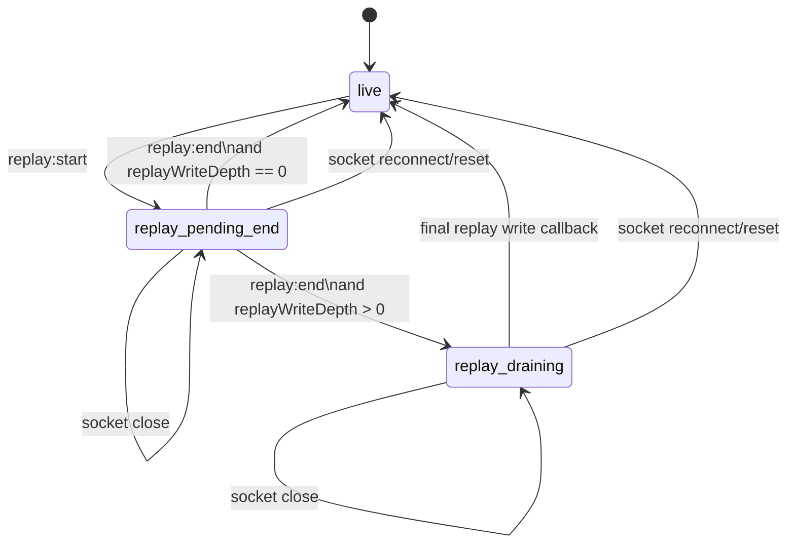
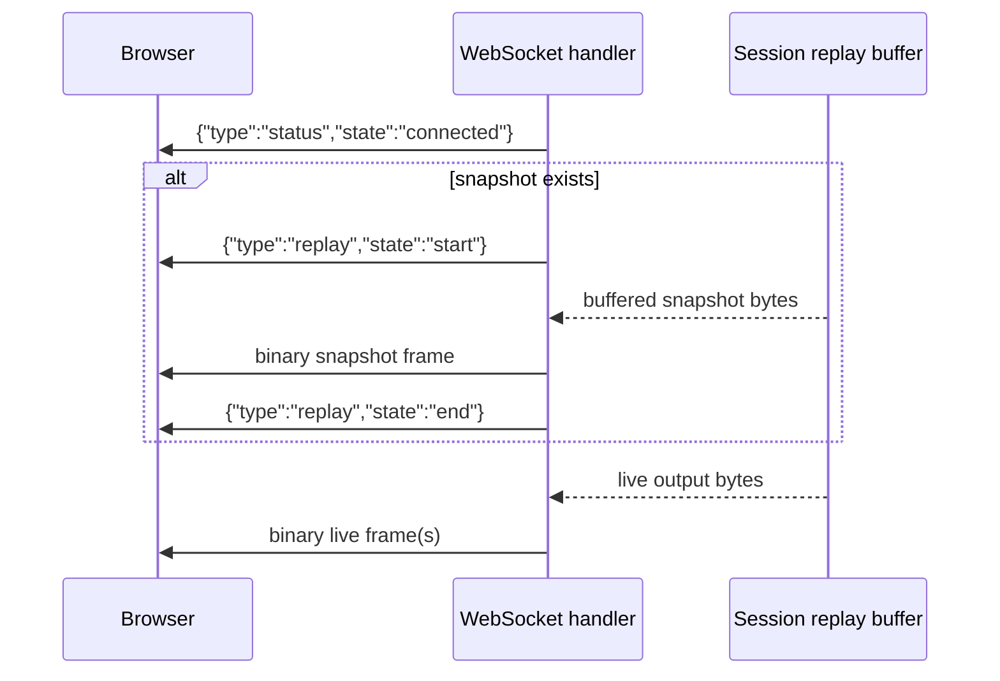

# Behavior: WebSocket protocols

> Part of the [behavior specification](../behavior.md). That document carries startup, configuration, and operational assumptions.

## Browser connection policy

All WebSockets apply the [shared browser request guard](../security/auth.md#shared-browser-request-guard)
before upgrading. Another hostname or port in Origin is refused with `403`, including another
loopback port without Fetch Metadata. `Sec-Fetch-Site: same-site` and `cross-site` are refused;
Origin-free CLI requests without browser headers remain supported; an Origin-free browser
request requires a matching Referer and consistent Fetch Metadata. TLS termination is supported by comparing hostname
and effective port, not transport scheme; another scheme on the same explicit port remains a
limitation. Development HTTP and WS proxies preserve Host and Origin.

## Command Center WebSocket Protocol

See the [Command Center protocol](command-websocket.md) for `/ws/board/command`, authentication,
query frames, deadlines, cancellation and resume continuity.

## WebSocket Protocol

Endpoint: `GET /ws/{sessionID}`

Connection behavior:

- `404` if the session ID does not exist. After a successful `/restart` this cannot happen for a
  pane that was previously running; if `/restart` itself fails, the pane's prior session stays
  registered (see [`POST /api/sessions/{id}/restart`](rest-api.md#post-apisessionsidrestart)), so
  this 404 is limited to session IDs that were never created in the first place.
- initial text frame is a JSON status message with `type: "status"` and `state: "connected"`
- if a reconnect has buffered output, the backend sends `{"type":"replay","state":"start"}`,
  replays up to the recent per-session output buffer as a binary frame, then sends
  `{"type":"replay","state":"end"}` before streaming live output
- if there is no buffered output, live output starts immediately after the connected status

Frame behavior:

- binary frame from browser to server: raw terminal input bytes
- binary frame from server to browser: raw terminal output bytes
- text frame from browser to server: JSON control message

Supported control messages:

```json
{ "type": "resize", "cols": 120, "rows": 40 }
```

```json
{ "type": "replay", "state": "start" }
```

```json
{ "type": "replay", "state": "end" }
```

Resize messages with zero dimensions are ignored. Invalid JSON control frames are ignored rather than terminating the session.

Replay state machine:

| State | Entry condition | Allowed events | Exit condition | Frontend effect |
|---|---|---|---|---|
| `live` | initial steady state, or replay has fully completed | live binary output, `replay:start`, socket close, socket reconnect | `replay:start` or socket teardown | `disableStdin = false`; terminal input and xterm-generated replies may flow normally |
| `replay_pending_end` | `replay:start` received | replay binary output, `replay:end`, `replay:end` write failure, socket close, socket reconnect | `replay:end` or socket teardown | `disableStdin = true`; replay bytes may still be arriving |
| `replay_draining` | `replay:end` received while one or more replay writes are still in flight | replay write callback completion, socket close, socket reconnect | last replay write callback completes | `disableStdin = true`; no new replay bytes are expected, but already-scheduled writes may still cause xterm side effects |

A socket close or replay-control write failure may leave stale replay state. Every reconnect resets
to `live` before processing new frames, so partial replay cannot leave stdin suppressed.

Frontend replay state diagram:



Backend replay emission order:



Alloy model:

- The replay state machine above is mirrored in [replay_state.als](../models/replay_state.als).
- The model abstracts the frontend into three states: `Live`, `ReplayPendingEnd`, and `ReplayDraining`.
- It checks these invariants:
  - `Live` never leaves `disableStdin` enabled
  - replay states always keep `disableStdin` enabled
  - `ReplayDraining` is only reachable while replay writes remain queued
  - `ReplayEndWriteFail` leaves the model in `ReplayPendingEnd` until reconnect
  - `SocketClose` does not falsely restore `Live` while replay is incomplete
  - `Reconnect` always resets the model to a clean `Live` state
  - stale replay suppression cannot survive in `Live`
- Any implementation that introduces or changes observable state transitions should ship with an
  Alloy model in `docs/models/` that captures those transitions.
- When state-transition behavior changes, update the corresponding Alloy model in the same change.
- To inspect counterexamples locally, open the model in Alloy and run the bundled `check` commands.
- CI runs Alloy model checks only when files under `docs/models/` change, so transition-changing
  code changes are expected to update the model if they need model-check coverage.

When the backend session reaches EOF, the handler emits:

```json
{ "type": "status", "state": "exited" }
```

## Task Event WebSocket Protocol

Endpoint: `GET /ws/tasks/events`

The stream of the running agent tasks' state changes: a snapshot on connect, then one JSON text
frame per change, ordered by `epoch` and `seq`. It is unauthenticated like `/ws/{sessionID}` and
refuses cross-site requests like `GET /api/tasks`. The model, the frames and the lifecycle are in
[Task events](task-events.md).
