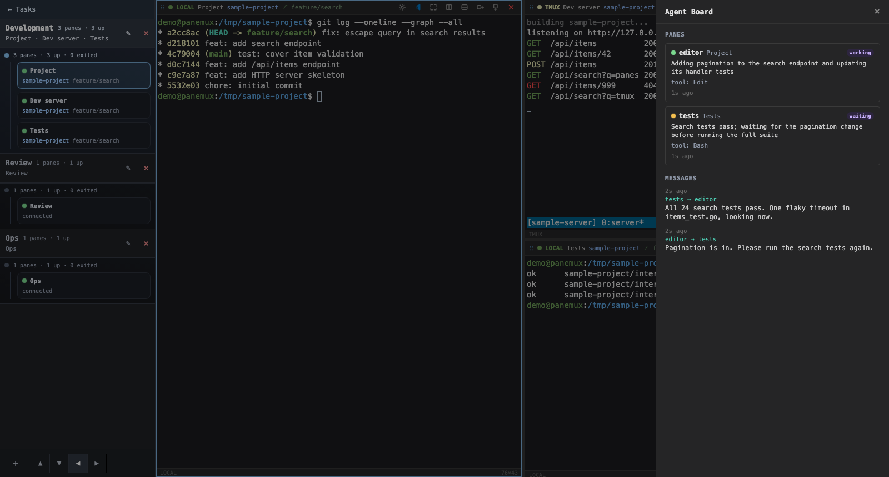
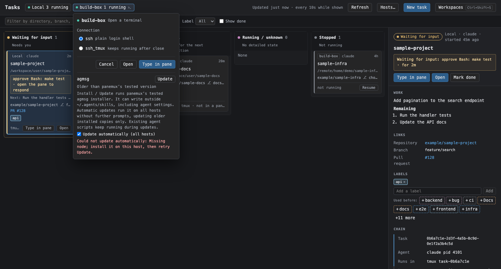

## Agent Board UI

Agent Board reuses the existing modal, panel, color, status, and focus-restoration patterns.

### Dashboard

- Opens from the Agent Board button or `Cmd/Ctrl+Shift+B`; both are absent when the capability is
  disabled.
- Appears as a right-side overlay and closes by button, backdrop, or `Escape`.
- Lists panes with a detected agent or a status report. Idle shells remain hidden until reporting.
  A detected pane without a report shows `agent detected`, which does not claim a successful join.
  Pane Settings has no board controls; global enablement lives in YAML and mode is ignored.
- Shows pane ID, title, state, summary, last tool, and report age. It does not show self-reported
  repository, branch, or PR values because the pane header already provides panemux-derived values.
- Treats state as free text and maps known states to the existing status palette: `working` green,
  `idle` blue, `waiting` attention gold, and everything else neutral.
- Keeps identity and metadata on one line; summaries may wrap to four lines.
- Marks reports older than five minutes as `stale` and dims rather than hides them.

### Command center

- `Cmd/Ctrl+Shift+K` opens a focused command palette. Plain `Cmd/Ctrl+K` remains available to common
  shell/readline bindings.
- Each prompt creates one turn containing the prompt, streamed output, progress state, and any
  inline error. A failed turn does not close or disable the palette.
- Command history uses a right-side panel for longer reading alongside terminal work.
- Command-center entry points are absent when the capability is disabled.

Global shortcuts use capture phase so terminal focus does not swallow them. Closing any Agent Board
surface restores the previously focused element. Full data-flow rules are in
[Command center](../agent-board/command-center.md#command-center).

### agmsg in the host menu

When Agent Board is globally enabled, HostTools lists agmsg using HostToolItem beneath the host
menu actions. It shows Not installed / Install, older release / Update, Installed with version,
newer release warning (kept unchanged), Cannot install with setup reasons, or Not checked.
Install / Update explains that the tested installer can write outside the skill directory and
that existing agent scripts keep running. Errors preserve installer exit/output details; success
asks agents to restart and explains that panemux participates from its next poll.
**Update automatically (all hosts)** is the same global preference in every host menu, including
hosts with newer or unconfirmed copies. Consent remains visible beside it even when no manual
action is offered, explaining unattended execution and writes outside the skill directory.
During automatic work the menu asks to reopen for the result; automatic failures remain visible
with manual Update available for retry, and success reports Updated automatically with restart guidance.

