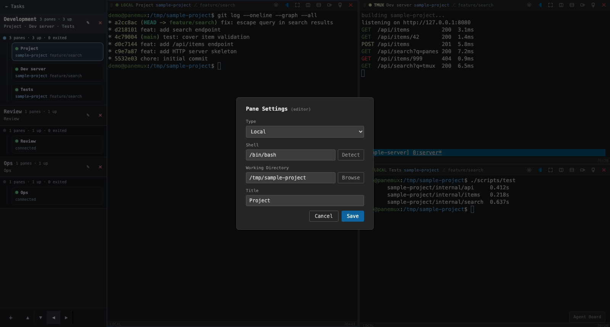

# Modal Dialogs

Modal dialogs hold higher-friction configuration tasks.

### Keyboard behaviour, shared by every modal

Every surface declaring `aria-modal="true"` uses `useModalKeyboard`:

- Tab and Shift+Tab cycle inside the dialog. A Tab from outside enters at the first or last
  focusable element according to direction.
- Escape is captured before xterm can stop keydown propagation.
- A dialog saving changes omits its Escape handler but retains the focus trap.
- A nested modal takes over the trap; the form behind it stays out of reach.

### Open in workspace

A task's Open (card, details or Type in pane popup) and a host menu's Open use
`WorkspacePickerDialog`, centred on a dimmed backdrop with the shared dialog surface and keyboard
trap. It lists workspace names as radios, focuses and selects the active workspace on opening,
and always appears even with one workspace. The last option, **+ New workspace**, reveals and
focuses **Workspace name**; **Open here** becomes **Create and open**. Names are trimmed; blank
or duplicate names show an inline error. Cancel, Escape and × dismiss it without adding a pane,
returning focus to the opener when still present. During confirmation controls are disabled and
Escape does not dismiss it. Request failures stay in the dialog; a workspace created before its
name fails to save remains selected under its default title; retrying **Open here** reuses it.
A newly created workspace includes its default local **Terminal** shell, with the requested pane
added at the right edge. Retrying after a session or layout was created resumes those completed
steps without duplicating them. Successful confirmation activates the chosen workspace and
focuses and outlines the new pane. **Go to pane** navigates immediately without this dialog.

### Confirmation dialog

Destructive actions use `ConfirmDialog`, so terminals keep rendering while confirmation is open.
It uses the shared dialog surface (`#252526`, `#444` border). Cancel, backdrop and Escape cancel;
only Confirm sends the request. Confirm takes initial focus. Destructive confirmation uses
`#5a1d1d`, `#7f1d1d` and `#fca5a5`. Workspace deletion sends its request only after confirmation.
