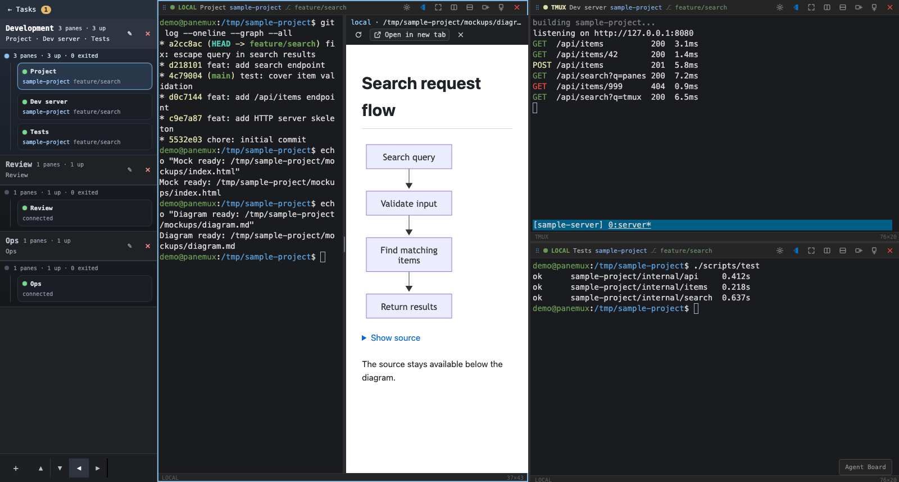

## Pane URL Strip

Opening a URL out of a pane can need the operator's attention twice: before anything opens, when a
program inside the pane asked for it, and after, when the port forward it needed could not be
established.

Both use one strip pinned to the top of the pane's terminal area, inside that pane rather than at
the workspace level, because both belong to one pane's activity:

- the request state names the URL and offers `Open` and `Ignore`; it never opens anything on its own
- the failure state reuses the transient-error palette (`#f4a9a9` on the pane's own surface with a
  `#7f1d1d` edge) and offers `Dismiss`
- a pending request takes precedence over an older failure, so the operator is never asked to read
  two things before deciding one
- the URL is truncated with an ellipsis and carries the full value as a tooltip, so a long
  authorization URL cannot push the buttons out of a narrow pane

The request state is deliberately not a modal: it belongs to one pane, and the operator should be
able to keep working in other panes — or read the surrounding terminal output that explains what
asked for it — before deciding.

## Split Preview

A clicked HTML or Markdown path opens beside the terminal rather than over it (issue #385), in a
workspace pane and in the task dashboard's Type in pane popup alike: the point is to check a mock
while still instructing the agent in the same terminal. [Behavior](../behavior/preview.md) has the full
rules.

- The terminal keeps the left side and the preview takes the right, starting at 50:50. The pane
  header, status bar and every pane operation stay as they are; the split lives in the pane's body.
- The preview header follows the mock in #359: the host (`local`, or the SSH host's connection
  name) in the accent blue, then the absolute path — or, for a relayed localhost URL of an SSH host,
  the URL as clicked, not the relay's address — truncated with the full value as a tooltip; below it Reload, an outlined
  `Open in new tab`, and Close. Opening larger is a new tab — the preview has no full screen of its
  own, so the terminal is never hidden behind it.
- While the previewed page has focus, a one-line note under the header says that keys go to the
  page and the terminal takes them back: the page is sandboxed in another origin, so panemux's
  shortcuts cannot hear keys typed in it, and the note keeps them from failing silently. It is a
  status, not an alert, and goes as soon as focus leaves the page.
- The divider is a 6 px bar with a centered grip. It highlights in the accent blue on hover, focus
  and while dragged; it is a focusable `separator` that the arrow keys move and a double-click
  returns to 50:50. Neither side gets narrower than 160 px; in a narrow pane its range narrows to
  match, so its announced value, its key steps and the drawn split agree.
- Loading, the reason a path cannot be opened, and the choice between files a relative path names
  are shown in the preview's own area, so the terminal is never covered and keeps taking keys.
- The preview's page is white like a browser page, framed by the dark panemux chrome.
- Mermaid diagrams in Markdown retain a **Show source** disclosure below each drawing. A failed
  diagram opens its source and shows its error within that block; the rest of the document stays
  readable. SVG diagrams fit the preview width and scroll when necessary.
- A localhost URL (issue #386) opens in the same split. Above its page, a one-line note in the same
  style as the keys note says that a page refusing to be framed stays blank and that hot reload,
  sign-in or storage can differ in a frame, pointing at `Open in new tab`: a frame cannot report
  either, so the note is always shown for a localhost page rather than guessed at.
- The pane's URL strip adds `Preview` before `Open` and `Ignore` when the URL is a localhost page on
  the panemux host, and says `This link goes to` instead of `This pane wants to open` for a clicked
  OSC 8 link. The strip covers the terminal side only — the whole body when no preview is open — so
  an open preview's header stays visible while another URL is asked about. The Type in pane popup
  draws the same strip over its terminal.

---

