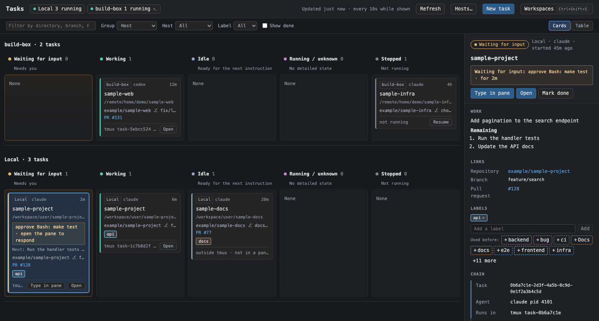
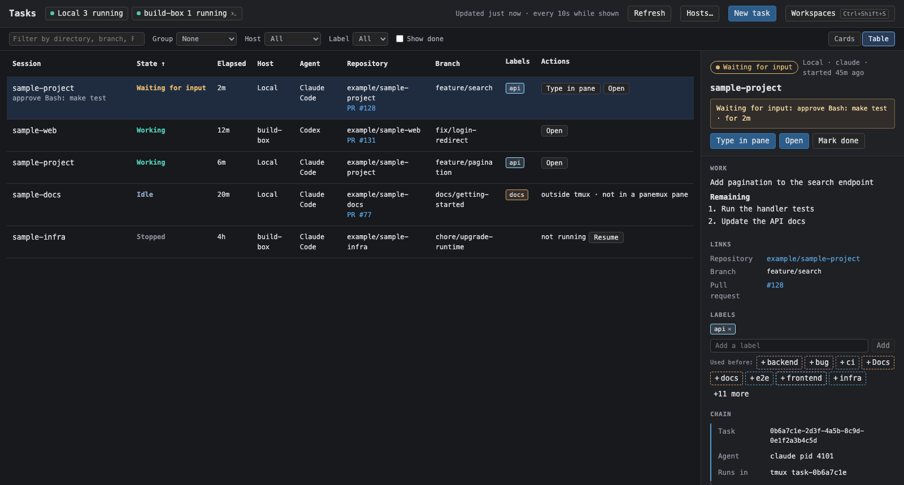

# Task Dashboard

The task dashboard ([behavior](../behavior/tasks.md)) is a second layer over the workspaces rather than
an overlay panel: it covers the whole window, and the workspaces stay mounted beneath it so every
terminal keeps its connection and scrollback. While it is shown the workspace layer is `inert`, so a
terminal that had focus cannot receive what is typed into the dashboard.

## Navigation and top bar

The initial layer is Workspaces. Its `← Tasks` button shows a gold last-collected waiting count,
with "when last checked" in its accessible name. The dashboard's Workspaces button shows its
shortcut; captured `Cmd/Ctrl+Shift+<display.task_dashboard_shortcut>` (default S) switches layers
from terminal focus too. On the dashboard, palette/history/Agent Board close and their K/B
shortcuts do nothing because they belong to the inert workspace layer.

The top bar has title and host chips (`Local`, running count; red error with Reconnect; or
`connecting…`). Long errors truncate with full tooltips. Right-aligned actions are `⚠ <n> unreadable`,
last-updated time, Refresh, Hosts…, blue New task and Workspaces. The actions wrap together,
flush right, and wrap internally only when too narrow for the group itself.

## Lists and filters

[Opening a task](../behavior/tasks.md#opening-a-task) owns view-state lifetime and browser storage,
filter restoration, grouping, sorting, notification focus and scroll, and selection across list changes.
[Done and labels](../behavior/tasks.md#done-and-labels) owns Done placement and label identity.

- The filter row offers text search (title, directory, branch, PR/reference, session/tmux name and
  summary), Group (None / Host / Label / Repository), host, label and `Show done` (initially off).
  Matching any substring ignores case and includes summaries not shown on cards, pending or outdated summaries;
  arrivals re-filter immediately. `task` matches the generated `task-<8 hex>` session names.
- Native pressed-state Cards / Table buttons change the list. The semantic table has nine columns:
  Session (title and short summary or wait reason), State, Elapsed, Host, Agent, Repository and PR,
  Branch, Labels, Actions. Session buttons select details; links/actions do not select rows.
  Done and labels are edited in details. Headers are sticky; one focusable region scrolls the
  table horizontally, retaining the responsive details panel on narrow screens.
- Sortable headers are native buttons with an arrow, direction in their accessible name, and
  `aria-sort` only on the active heading. Defaults, ordering and tie rules are in behavior.
- Kanban columns are Waiting for input (gold, "Needs you"), Working, Idle, Running / unknown,
  Stopped, and optionally Done. The board is a keyboard tab stop named "Task board".
  Groups span all state columns: group heading/count, local state counts and equal-height bodies
  set by the tallest stack. Empty columns say `None`; empty grouped boards say `No tasks`.
  Catch-all groups (`Not in a Git repository`, `No label`) sort after named groups.
  Ungrouped column headers stay visible while the board scrolls.
  One sticky group/state band gives way to the next. Rows share column widths and a horizontal
  scroll position, including below 560px and beside details; ungrouped narrow boards stack vertically.

## Cards

Cards have a state-color left border; host, agent and state duration; directory basename title
and full path; wait reason and "open the pane to respond", or a two-line summary dimmed if outdated.
Remaining work adds `Next: <first remaining item> · <n> left`. Repository, branch, PR/issue/reference
links open new tabs (`PR #87`, `Issue #252`, `JIRA-123`; cross-repository issues use `owner/name#9`).
Labels keep a stable color. Meta shows green Done for running done tasks, dashed green Done? for
done candidates, blue Typing while the popup is open, and `<agent> (unknown agent)` if unregistered.
The bottom shows execution location and capability-based actions or the reason unavailable
("not in a panemux pane", "its pane is in no workspace"). The card selects on click; its title is
a button, so links and actions never nest in another interactive element.

[Task Actions](task-actions.md) defines creation, details and terminal popups;
[Dashboard Hosts](dashboard-hosts.md) defines host menus, tools and host editing.

State colors:

| State | Color |
|---|---|
| Waiting for input | `#e2b86b` |
| Working | `#4ec9b0` |
| Idle, Running | `#8fa6c4` |
| Unknown | `#c586c0` |
| Stopped | `#80858d` |
| Done | `#7fae6a` |

Label colors come from the mock's palette (`#569cd6`, `#4ec9b0`, `#9cdcfe`, `#d7a26b`, `#b48ead`,
`#c678dd`, `#8a9199`, `#e06c6c`), picked by a hash of the label so a label keeps its color.
