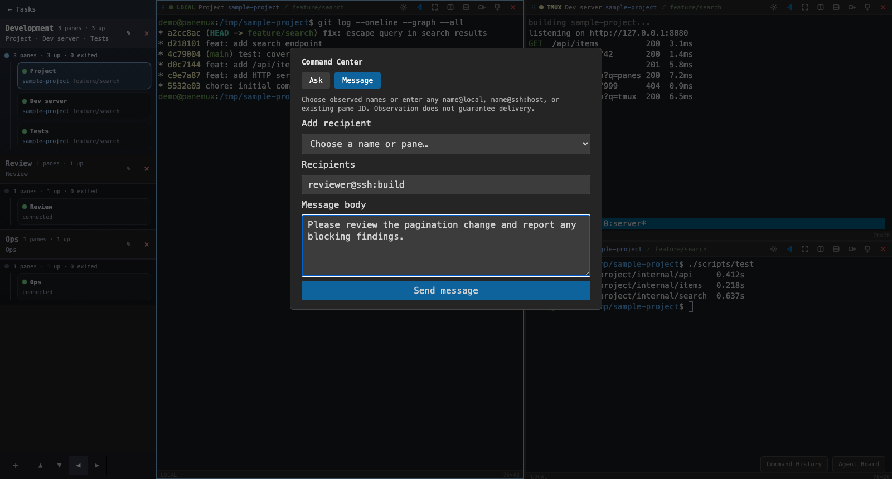

# Agent Board UI

Agent Board reuses the shared modal, overlay-panel, color, status, and focus-restoration patterns
([UI Overview](overview.md)).

## Dashboard

- Opens from the Agent Board button or `Cmd/Ctrl+Shift+B`; both entry points are absent when the
  capability is disabled.
- Appears as a right-side overlay and closes via button, backdrop, or `Escape`.
- Lists observed names by their full `name@BoardID`, always showing the host and either the matching
  pane ID/title or `No pane`. Equal names on `local` and `ssh:build` have separate cards. Matching
  pane details appear once, in the name card; unmatched detected/reporting panes remain under
  `Detected panes`. Idle configured shells stay hidden. Detection does not claim a successful join.
- `Task observed`, `Self-report`, and `Unreported` identify the source supplied by the server.
  Task state, waiting reason, state age, and observation age take priority; an accompanying
  self-report is explicitly supplemental. Ambiguous task locations, failed collections, and
  connection changes use the server's fallback without client-side matching or new expiry rules
  ([identity contract](../api/agent-board.md#identity-entries)).
- A message-only name may be `Unreported`. Listing a name does not guarantee registration,
  liveness, or delivery. Each name card offers `Copy address`, reporting success or failure.
  Names without panes have no pane navigation, attach, or settings actions.
- Displays self-reported state, summary, last tool, and report age as React text, with no HTML,
  Markdown, or automatic links. Self-reported repository, branch, PR, and directory values remain
  omitted. Pane Settings exposes no board controls; global enablement lives in YAML and legacy
  `mode` is ignored.
- Treats state as free text and maps known states to the status palette: `working` green, `idle`
  blue, `waiting` attention gold, and everything else neutral.
- Qualified names and hosts wrap rather than lose their distinguishing suffix. Summaries preserve
  newlines, initially wrap to four lines, and offer `Show more` / `Show less`. Display normalizes
  CRLF to LF and tabs to spaces; other C0/C1 and bidirectional control characters appear as literal
  `\uXXXX` escapes. API data and accepted input lengths are unchanged.
- Marks self-reports older than five minutes as `stale`, dimming cards whose primary state is a
  self-report. A stale supplemental report does not dim a primary task observation.
- Message history always shows source host. Ordinary senders display as `name@source-host`, while
  reserved `_system` retains its name. Qualified destinations remain exact, and bare destinations
  remain as stored; current pane ownership is never used to reconstruct a past recipient host.

The screenshot uses a presentation-only status fixture for equal names on separate hosts and task
priority. It does not exercise live SSH; the message feed still comes through the relay fixture.

## Command center

- `Cmd/Ctrl+Shift+K` opens a focused command palette. Plain `Cmd/Ctrl+K` remains free for standard
  shell and readline bindings.
- **Ask** preserves the natural-language prompt and streamed conversation. Each prompt creates one
  turn containing the prompt, streamed output, progress state, and any
  inline error. A failed turn does not close or disable the palette.
- Command history opens as a right-side panel for longer reading alongside terminal work.
- Command-center entry points are absent when the capability is disabled.
- **Message** sends directly through authenticated `POST /api/board/broadcast`, independently of
  the Claude connection. `Add recipient` offers observed qualified names and compatible pane IDs;
  `Recipients` also accepts unobserved qualified names and comma-separated destinations. The list
  is a convenience, never an authorization or roster requirement. Server validation owns name and
  host rules; the UI does not duplicate the SSH connection-key validator.
- Sending disables draft edits and repeat submission. Results distinguish `Not sent` validation
  errors (`422`), actual delivered and unsent destinations on downstream failure (`502`, including
  zero deliveries), and `Delivery unknown` for transport or unrecognized responses. Nothing is
  retried automatically; check history before retrying an uncertain or partial outcome. Draft
  recipients and body remain available; editing clears the previous result. Mode switches retain
  drafts and pending sends while the palette stays open.
- Direct messages appear in Board message history after polling, not as fabricated Claude turns.
  Message mode is absent along with the palette when the command-center capability is disabled.
- Global shortcuts register in capture phase so terminal focus does not swallow them. Closing any
  Agent Board surface restores the previously focused element. Full data-flow rules live in
  [Command Center execution](../backend/agent-board/command-center.md).

## agmsg in the host menu

When Agent Board is globally enabled, `HostTools` lists agmsg via `HostToolItem` beneath the host
menu actions. It shows `Not installed` / `Install`, older release / `Update`, `Installed` with
version, newer release warning (kept unchanged), `Cannot install` with setup reasons, or
`Not checked`.

- `Install` / `Update` explains that the tested installer can write outside the skill directory and
  that existing agent scripts keep running. Errors preserve installer exit/output details; success
  asks agents to restart and explains that panemux participates from its next poll.
- **Update automatically (all hosts)** edits the single global preference in every host menu,
  including hosts with newer or unconfirmed copies. Consent stays visible beside it even when no
  manual action is offered, explaining unattended execution and writes outside the skill directory.
- During automatic work the menu asks to reopen for the result; automatic failures remain visible
  with manual `Update` available for retry, and success reports `Updated automatically` with restart
  guidance.

