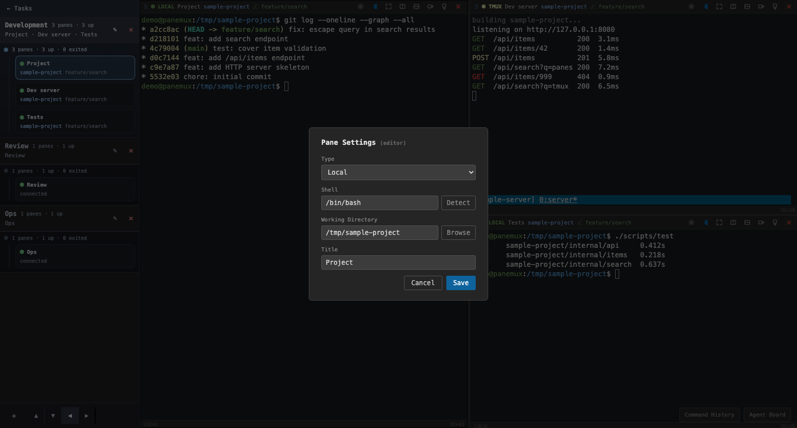

# UI Overview and Frontend Runtime

Split, close, maximize, settings, new panes, workspace add/rename/delete, and pane moves are
available during terminal work without a separate edit mode. Domain-specific surfaces live in
[Workspace UI](workspace.md), [Task Dashboard and Attention UI](tasks.md), and
[Agent Board UI](agent-board.md); HTTP and WebSocket wire contracts live in [API](../api/index.md).

## Design principles

Three core principles guide the interactive UI:

- **State Visibility** — the user always knows what action is available and what action is in
  progress. Pane movement, pane insertion, transient errors, and modal editing stay visible without
  hidden modes.
- **Affordances** — visual cues match physical intuition. Grab cursors indicate draggable elements.
  Edge highlights and divider overlays show where a pane can land. Buttons that create or mutate
  layout stay grouped with the structure they affect.
- **Feedback** — transitions between states are animated (`0.15–0.2 s`) to prevent abrupt jumps and
  keep cause and effect legible. A ghosted drag source, grabbing cursors, and visible alerts on
  failed persistence keep the UI honest when optimistic updates are used.

## Color palette

| Role | Value | Usage |
|---|---|---|
| Interactive blue | `#569cd6` | drop-target highlight, selected workspace-position control |
| Drag handle blue | `#4a7ea5` | header move handle `⠿` |
| Normal header background | `#252526` | pane header background |
| Normal header border | `#333` | pane header bottom border |
| Workspace bar background | `#202124` | workspace bar surface |
| Active workspace tab | `#2f3540` | active workspace tab background |
| Position-control selected | `#3a4350` | selected top/bottom/left/right tab-position button |
| Dialog background | `#252526` | modal dialog surface |
| Dialog border | `#444` | modal dialog outline |
| Error banner background | `#2f1313` | move-persistence failure alert |
| Error banner border | `#7f1d1d` | move-persistence failure alert border |
| Error banner text | `#fca5a5` | move-persistence failure alert text |

## Modal dialogs

Modal dialogs hold higher-friction configuration tasks.



### Keyboard behaviour, shared by every modal

Every surface declaring `aria-modal="true"` uses `useModalKeyboard`:

- `Tab` and `Shift+Tab` cycle inside the dialog. A `Tab` from outside enters at the first or last
  focusable element according to direction.
- `Escape` is captured before xterm can stop keydown propagation.
- A dialog saving changes omits its `Escape` handler while retaining the focus trap.
- A nested modal takes over the trap; the form behind it stays out of reach.

### Open in workspace

A task's Open (card, details, or Type in pane popup) and a host menu's Open use
`WorkspacePickerDialog`, centred on a dimmed backdrop with the shared dialog surface and keyboard
trap. It lists workspace names as radios, focuses and selects the active workspace on opening, and
always appears even with one workspace. The last option, **+ New workspace**, reveals and focuses
**Workspace name**; **Open here** becomes **Create and open**. Names are trimmed; blank or duplicate
names show an inline error. Cancel, Escape, and `×` dismiss it without adding a pane, returning
focus to the opener when still present. During confirmation controls are disabled and Escape does
not dismiss it.

Request failures stay in the dialog; a workspace created before its name fails to save remains
selected under its default title, and retrying **Open here** reuses it. A newly created workspace
includes its default local **Terminal** shell, with the requested pane added at the right edge.
Retrying after a session or layout was created resumes those completed steps without duplicating
them. Successful confirmation activates the chosen workspace and focuses and outlines the new pane.
**Go to pane** navigates immediately without this dialog.

### Confirmation dialog

Destructive actions use `ConfirmDialog`, so terminals keep rendering while confirmation is open. It
uses the shared dialog surface (`#252526`, `#444` border). Cancel, backdrop, and Escape cancel; only
Confirm sends the request. Confirm takes initial focus. Destructive confirmation uses `#5a1d1d`,
`#7f1d1d`, and `#fca5a5`. Workspace deletion sends its request only after confirmation.

## Frontend runtime

### Initial page load

```text
Browser loads SPA
  -> GET /api/layout
  -> GET /api/display
  -> validate JSON with Zod
  -> render recursive split tree
  -> each TerminalPane opens /ws/{sessionID}
```

### Terminal I/O and recovery

```text
User types in xterm.js
  -> browser sends binary WebSocket frame
  -> session.Write(...)
  -> shell/SSH/tmux produces output
  -> session.Read(...)
  -> backend sends binary WebSocket frame
  -> xterm.js writes bytes to the terminal
```

During replayed reconnect output, xterm stdin is suppressed until the replay end marker is fully
applied ([Terminal WebSocket protocol](../api/workspace.md#terminal-websocket-protocol)), so
terminal query responses embedded in old output are not regenerated as fresh shell input.

When an SSH-backed pane loses its transport unexpectedly, panemux classifies that session as
`disconnected` instead of `exited`. The frontend performs one automatic recovery attempt by
recreating the session and reconnecting the pane. Deliberate remote shell termination such as
`exit` remains `exited` and shows the restart action instead of auto-reconnecting.

The same one-shot automatic recovery also triggers if the pane's WebSocket connection itself
repeatedly fails to (re)establish and exhausts its own reconnect attempt budget, even if the backend
never reported a `disconnected` status frame (for example during a prolonged network outage that
prevents the WebSocket handshake from completing at all). Either way, if the automatic recovery
attempt itself fails, the pane shows the manual **Reconnect Session** action instead of showing the
`reconnecting...` indicator forever.

### Selection and copy behavior

- Terminal text can be selected with the mouse using xterm.js standard selection behavior.
- If text is selected, `Cmd+C` or `Ctrl+C` copies the current selection instead of sending terminal
  input.
- If no text is selected, `Cmd+C` or `Ctrl+C` is left to normal terminal behavior, so shell
  interrupts still work.
- This interaction is currently validated in Chrome.
- Panemux keeps tmux mouse mode unchanged for `tmux` and `ssh_tmux` panes. Plain drag therefore
  continues to follow tmux mouse behavior. To force browser-side xterm selection while tmux mouse
  mode is active, hold `Option` during drag on macOS or `Shift` during drag on Linux and Windows.

### Terminal link detection

- `http://` and `https://` URLs printed into a pane are auto-detected and become clickable through
  panemux's own xterm.js link provider (`createUrlLinkProvider` in
  `frontend/src/utils/terminalLinks.ts`).
- `TERMINAL_URL_REGEX` (`frontend/src/hooks/useTerminal.ts`) excludes ASCII punctuation from URL
  endings (`.`, `,`, `:`, `!`, `?`, `)`) as well as CJK and fullwidth punctuation. Trailing `。`,
  `、`, `・`, `…` and enclosing `（）`, `「」`, `【】`, `“”` are not part of the detected link.
- Non-ASCII *letters* are never excluded, so raw IRIs such as
  `https://ja.wikipedia.org/wiki/日本語` stay linkable in full. Fullwidth digits and fullwidth
  letters stay linkable for the same reason, as do the letters and numerals interleaved into the CJK
  symbols block (`々`, `〆`, `〇`, and the ideographic numerals), so
  `https://ja.wikipedia.org/wiki/日々` is linked whole.
- **Known limitation (trailing kana/kanji)**: kana or kanji directly following a URL with no
  delimiter (such as `https://example.com/docsを参照`) is still absorbed into the link, because it
  cannot be distinguished from a legitimate kana IRI path by pattern matching alone. Separate the
  URL with whitespace or punctuation, or emit an OSC 8 hyperlink (which xterm.js resolves
  independently and asks to confirm before navigating).
- A URL that does not fit the pane is linked whole across every row it occupies, whether the
  terminal wrapped it or the program printed its own newline at the pane edge (as in bordered TUIs,
  formatted CLI output, and tmux line redraws that do not set `isWrapped`).
- Two rows are read as one line when the terminal wrapped them, or when the upper row runs all the
  way to the pane edge and the lower row starts with something other than a blank. A row whose last
  column holds the trailing half of a wide character counts as reaching the edge. That heuristic can
  join two unrelated rows that meet both conditions; the alternative is a truncated clickable URL
  cut inside its hostname.
- When adjacent rows share Unicode box-drawing characters at the same left and right cell columns,
  those decorations and one optional inner padding cell per side are removed before applying the
  continuation rule. The left and right decorations may differ from each other, and inner padding is
  not required. The characters and cell columns must match between rows; ASCII `|` is never treated
  as a frame. This keeps ordinary piped output out of the heuristic while keeping URLs wrapped
  inside TUI frames such as `│ https://… │` as one link.
- A match that runs to the pane edge of the last row with nothing continuing it is not offered as a
  link at all: whether the URL ended there or continues off screen is unknowable.
- **Known limitation (early line break)**: a URL broken well short of the pane edge (such as
  `https://exam\r\nple.com/path` on an 80-column pane) is still linked as the fragment, because a
  line stopping 60 columns early is indistinguishable from one that ended there.
- `#<number>` references are linked separately to the pane's GitHub pull request
  ([Pane Git and PR metadata](../backend/workspace/sessions.md#pane-git-and-pr-metadata)). The URL provider is registered first,
  so a `#123` inside a URL stays part of the URL; both providers report 1-based ranges on both axes
  mapped through cells rather than string indices so xterm can resolve overlaps accurately.

### Resize, persistence, and layout operations

- `ResizeObserver` triggers terminal fit logic when pane size changes and sends a `resize` control
  message with current `cols`/`rows`.
- Dragging split dividers updates layout percentages in memory during normal terminal use; layout
  persistence for resize is debounced by `500 ms` before `PUT /api/workspaces/{active}/layout`.
- Layout and workspace mutations persist immediately when a save path is available: pane resize,
  split, close, quick-add create, move, workspace add/delete/rename, active-workspace changes,
  `tab_position` changes, and vertical workspace-bar width changes all share the immediate-save
  path.
- When no `--config` is given, the default save path is `~/.config/panemux/config.yaml` (directory
  created automatically on first save).
- Pane maximize state is frontend-local, tracked per workspace, and restored when switching back to
  a workspace.
- Task and host Open select a destination before creating a pane
  ([Opening a task](../backend/tasks/lifecycle.md#opening-a-task-view-state-and-temporary-attaches)).

#### Layout editing and pane movement

Pane movement is a re-layout operation, not a session recreation:

- Moving a pane does not create or restart a backend session; only its position in the layout tree
  changes, calling only the workspace layout save path.
- When React remounts a moved pane under a different parent node, xterm.js instances survive via a
  module-level `TerminalEntry` map keyed by session ID; the existing canvas reattaches with
  `appendChild` rather than `replaceChildren`, preserving React-managed sibling overlays and restart
  controls.
- Dropping a pane on another workspace tab moves it into that workspace, inserts it at the
  destination workspace's right edge, persists both affected workspace layouts, and switches the
  active workspace to the destination.
- Dragging a pane card from the workspace summary view onto another workspace uses the same move
  path as dragging from the pane-header handle.

#### Split, close, and new terminal creation

- Splitting a pane creates a new local pane, calls `POST /api/sessions`, and rewrites the layout
  tree so original and new panes each receive `50%` under a new split node. The original pane keeps
  its visible terminal contents without going blank or resetting.
- Closing a pane calls `DELETE /api/sessions/{id}`, removes the pane from the tree, collapses
  single-child parents, and renormalizes sibling sizes to `100`.
- Pane headers expose one-click **Add new pane to the right** and **Add new pane below** actions
  that immediately create a default `local` pane beside the current pane.
- The new-terminal dialog supports two bases (blank `local` or cloning an existing pane's settings)
  and placement at workspace `top`/`bottom`/`left`/`right` or beside an existing pane on
  `top`/`bottom`/`left`/`right`:
  1. Build the new `PaneConfig`.
  2. Call `POST /api/sessions`.
  3. Insert the pane into the active workspace layout.
  4. Persist with `PUT /api/workspaces/{active}/layout`.
- For cloned `tmux` and `ssh_tmux` panes, `tmux_session` is regenerated to avoid collisions.
