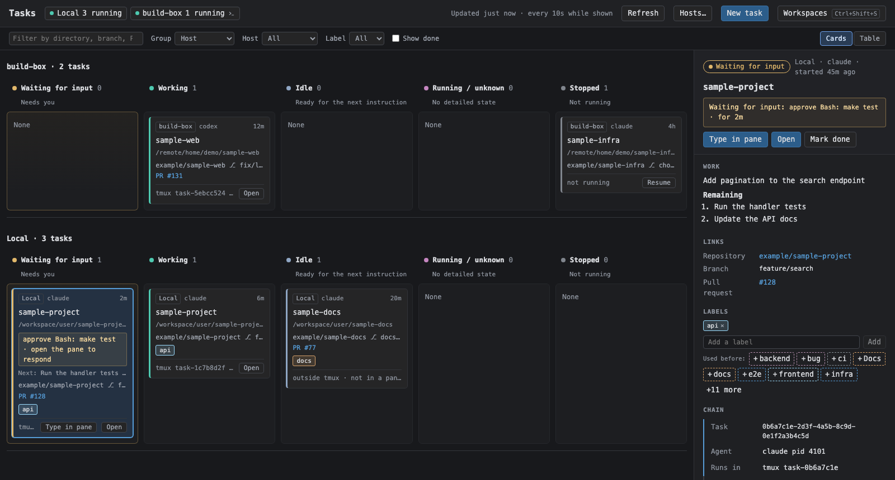
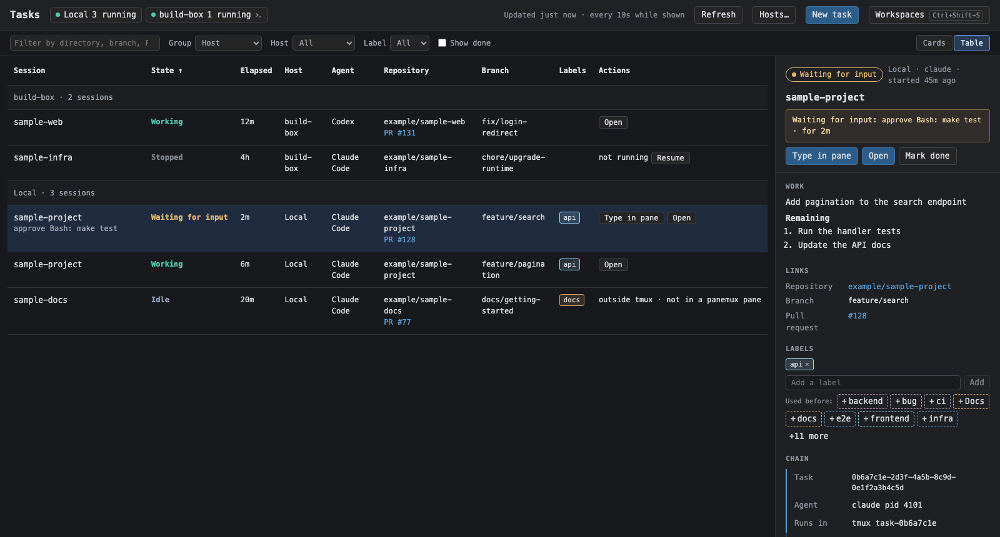

# Task Dashboard and Attention UI

The task dashboard ([behavior](../behavior/tasks.md)) is a second layer over the workspaces rather
than an overlay panel: it covers the whole window while workspaces stay mounted beneath it so every
terminal keeps its connection and scrollback. While the dashboard is shown, the workspace layer is
`inert` so a focused terminal cannot receive dashboard keystrokes.

## Navigation and top bar

- The initial layer is Workspaces. Its `← Tasks` button shows a gold last-collected waiting count
  with `"when last checked"` in its accessible name.
- The dashboard's Workspaces button displays its shortcut; captured
  `Cmd/Ctrl+Shift+<display.task_dashboard_shortcut>` (default `S`) switches layers even from
  terminal focus. On the dashboard, the command palette, history, and Agent Board close and their
  `K`/`B` shortcuts do nothing because they belong to the inert workspace layer.
- The top bar contains the title and host chips (`Local`, running count; red error with `Reconnect`;
  or `connecting…`). Long errors truncate with full tooltips.
- Right-aligned actions are `⚠ <n> unreadable`, last-updated time, `Refresh`, `Hosts…`, blue
  `New task`, and `Workspaces`. The actions wrap together flush right and wrap internally only when
  too narrow for the group itself.

## Lists, filters, and cards

[Task navigation](../behavior/task-navigation.md#opening-a-task) owns view-state lifetime, browser
storage, filter restoration, grouping, sorting, notification focus/scroll, and selection across list
changes. [Done and labels](../behavior/task-records.md#done-and-labels) own Done placement and label
identity.

### Filters, table, and Kanban board

- The filter row offers text search (title, directory, branch, PR/reference, session/tmux name, and
  summary), `Group` (`None` / `Host` / `Label` / `Repository`), host, label, and `Show done`
  (initially off). Case-insensitive substring matching includes summaries not shown on cards,
  pending summaries, and outdated summaries; arrivals re-filter immediately. Searching `task`
  matches generated `task-<8 hex>` session names.
- Native pressed-state `Cards` / `Table` buttons switch the list view. The semantic table has nine
  columns: `Session` (title and short summary or wait reason), `State`, `Elapsed`, `Host`, `Agent`,
  `Repository and PR`, `Branch`, `Labels`, `Actions`. Session buttons select details; links and
  actions do not select rows. Group headings and session counts span the table in separate row
  groups; label groups can repeat sessions. Done and labels are edited in details. Headers are
  sticky; one focusable region scrolls the table horizontally while retaining the responsive details
  panel on narrow screens.
- Sortable headers are native buttons with an arrow, direction in their accessible name, and
  `aria-sort` only on the active heading. Defaults, ordering, and tie rules live in
  [task navigation](../behavior/task-navigation.md#opening-a-task).
- Kanban columns are `Waiting for input` (gold, `"Needs you"`), `Working`, `Idle`,
  `Running / unknown`, `Stopped`, and optionally `Done`. The board is a keyboard tab stop named
  `"Task board"`.
- Groups span all state columns with group heading/count, local state counts, and equal-height
  bodies set by the tallest stack. Empty columns say `None`; empty grouped boards say `No tasks`.
  Catch-all groups (`Not in a Git repository`, `No label`) sort after named groups, and empty groups
  are omitted. Enabling `Done` adds a column to every group row at once; `None` grouping keeps one
  board including empty columns. The details panel stays outside the shared scroll area. Ungrouped
  column headers stay visible while scrolling, and one sticky group/state band gives way to the
  next. Rows share column widths and horizontal scroll position (including below `560 px` and beside
  details); ungrouped narrow boards stack vertically.

### Cards and color tokens

Cards show a state-color left border; host, agent, and state duration; directory basename title and
full path; wait reason with `"open the pane to respond"`, or a two-line summary dimmed when
outdated. Remaining work adds `Next: <first remaining item> · <n> left`. Repository, branch, and
PR/issue/reference links open new tabs (`PR #87`, `Issue #252`, `JIRA-123`; cross-repository issues
use `owner/name#9`). Labels keep a stable hash-selected color. Meta badges show green `Done` for
running done tasks, dashed green `Done?` for done candidates, blue `Typing` while the popup is open,
and `<agent> (unknown agent)` if unregistered. The card bottom shows execution location and
capability-based actions or the unavailable reason (`"not in a panemux pane"`,
`"its pane is in no workspace"`). Clicking the card selects it; its title is a button so links and
actions never nest inside another interactive element.

State colors:

| State | Color |
|---|---|
| Waiting for input | `#e2b86b` |
| Working | `#4ec9b0` |
| Idle, Running | `#8fa6c4` |
| Unknown | `#c586c0` |
| Stopped | `#80858d` |
| Done | `#7fae6a` |

Label colors come from the fixed palette (`#569cd6`, `#4ec9b0`, `#9cdcfe`, `#d7a26b`, `#b48ead`,
`#c678dd`, `#8a9199`, `#e06c6c`), chosen by hashing the label so each label keeps a stable color.

## Task actions and details

### Starting and selecting

[Starting a task](../behavior/task-launch.md#starting-a-task) owns launch fields, eligibility,
validation, label persistence, and execution.

- The modal shows `Host` (unreachable hosts marked `"(unreachable)"`), `Working directory`, `Agent`,
  optional comma-separated `Labels`, and `First instruction`. Show the server's launch note and
  unavailable-CLI reason below `Agent`; disable `Start` when unavailable.
- Focus starts on `Working directory` without opening suggestions; changing `Host` clears it. Empty
  or relative directories and empty instructions show inline errors below fields; server/host
  failures show `"Could not start: …"` while retaining input. While starting, show `Starting…` and
  disable all dismissal.
- On success, close the form and show a blue notice naming host and tmux session and explaining
  selection once the agent starts and Codex's pending labels. Collection selects the launched task
  unless the operator selected another task meanwhile (manual selection cancels auto-selection and
  clears the notice). Codex is selected as its process first (keeping the notice), then as its
  session when listed (clearing the notice). No pane opens. Failure to record a started task's
  labels shows a red alert.

### Details and actions

The right panel fills the window height; at `1000 px` and narrower it slides over the board with a
`Close` button. Its fixed head holds state, host, agent, start time, title, wait reason, and
actions; only the body scrolls. Action visibility and disabled reasons follow the server's declared
capabilities (unknown agents keep pane actions only).
[Task navigation](../behavior/task-navigation.md#opening-a-task),
[resuming](../behavior/task-launch.md#resuming-a-task),
[permission input](../behavior/task-codex-permissions.md#codex-permission-requests), and
[Done and labels](../behavior/task-records.md#done-and-labels) own availability, effects, and record
identity.

- `Type in pane` uses interactive blue; an unavailable waiting/idle task says
  `"Type in pane is not available: <reason>."`. A done candidate says
  `"The summary finds no work left: a candidate for Mark done."`.
- Body: server state notes, **Work**, links, labels, `task → agent → tmux → pane → workspace`,
  directory, and session ID. Only available link rows appear; issue links note
  `"closed by the pull request"`, and References note `"from the branch name or pull request title"`.
- **Work** shows summary and numbered remaining work, or `"No remaining work found."`. It shows
  `Summarizing…`, failures, outdated/unreadable states, disabled state (naming
  `task_dashboard.summary.enabled`), or `"Summarized when it stops working."` while busy without a
  summary. Offer `Summarize` / `Summarize again` when no current summary exists or the last attempt
  failed, showing refused requests below it. Unreadable logs keep a disabled button with a tooltip
  explaining the log cannot be read; after a log change, re-enable it and note
  `"The conversation has changed since it could not be read."`. Missing session/log disables
  summaries with a reason; agents without summary capability show no control.
  [Task summaries](../behavior/task-summaries.md#summaries) own scheduling, accounts, and retries;
  [Codex sessions](../behavior/task-collection.md#codex-sessions) own state-note meanings.
- `Mark done` asks inline, explaining the destination column and whether `Show done` hides it.
  `Mark not done` and `Input given` do not ask. Failed input confirmation appears under actions as
  `"Could not mark the input given: <reason>"`.
- Labels use `×` to remove, a text box and `Add`, plus [Used before](#labels-used-before) tags that
  add immediately and filter with input. When every known label is present, show
  `"Every label used before is on this task."`. Without a session ID, omit label/done controls with
  an explanation. Failed saves retain input and show their reason in the head only for the saved
  task while keeping other selections enabled.
- `Resume` shows `Resuming…` and disables only that task's action. Failures show in red naming the
  task; success selects the resumed task.

### Labels used before

Labels held in the record file (`known_labels`,
[Done and labels](../behavior/task-records.md#done-and-labels)) appear as tags in a `Used before:`
row under both label inputs (New task's `Labels` field and the detail panel's `Add a label` box)
rather than a dropdown. The label filter does not offer them.

- In New task, selected tags render as solid `✓` (`aria-pressed="true"`), unselected tags as dashed
  `+`. Clicking `+` replaces the text after the last comma unless it is already a complete used
  label, adds the label, and appends `, `; clicking `✓` removes only that label. The last fragment
  filters `+` tags while `✓` tags stay visible even when filtered or folded.
- Tags sort in case-insensitive alphabetical order, each in its label color.
- Typed text filters tags by case-insensitive substring; an empty field shows all. When none match,
  show `"No label used before contains “…”."` while still allowing the typed text to be added as a
  new label.
- More than eight tags after filtering fold to the first eight with `+<rest> more`, expanding to all
  and becoming `Show less` (`aria-expanded`, `aria-controls` on the row); eight or fewer show no
  fold button.
- Every tag and fold control is a button reachable with `Tab` and activated with `Enter` or `Space`.
- None are shown when none exist or when the record file cannot be read.

### Working directory suggestions

The `Working directory` combobox lists `Recent on <host>`: monospace path, agent, and last-used time
(`claude · 2h ago`, `codex · now`). [Starting a task](../behavior/task-launch.md#starting-a-task)
owns suggestion source, ordering, and lifetime.

- Clicking the field, pressing the `▾` button, pressing `↓`/`↑`, or typing opens the list; initial
  form focus does not. Typing filters by case-insensitive substring and highlights the matching
  fragment in accent blue.
- `↓`/`↑` move the highlighted row with wrapping; `Enter` inserts the highlighted path and closes
  the list (or submits the form when no row is highlighted); `Escape` closes only the list first,
  and a second `Escape` closes the form. Clicking a row matches `Enter`. Blur closes the list (`▾`
  focuses the input so blur works identically). IME composition keys (`Enter` confirming conversion)
  are left to the IME. The highlighted row follows its directory if a board update reorders rows.
- The input sets `role="combobox"`, `aria-autocomplete="list"`, `aria-expanded`, `aria-controls`,
  and `aria-activedescendant`. `aria-controls` targets the `listbox` (named by its heading, each row
  an `option` with `aria-selected`) or the empty-state message. `Tab` skips the `▾` button.
- Empty messages: `"No recent directory matches. Starting will use the path as typed."` when a
  filter matches nothing; `"No directory used on this host yet. Type an absolute path."` when the
  host has no collected directories.
- The list scrolls past roughly seven rows and has no remove-row control.

## Terminal popups

[Opening a task](../behavior/task-navigation.md#opening-a-task) owns Type in pane eligibility,
attach/input states, status notes, closing, and focus restoration;
[Opening a host](../behavior/task-navigation.md#opening-a-host) owns the host-terminal variant. Both
share this presentation:

- Centered over a dark backdrop at up to `1100×760` with `24 px` margins. Backdrop clicks do not
  close the popup so terminal text selection can end outside it. Everything behind it is `inert`.
- Header: task state pill and title, connection chip (`Connecting` grey, `Connected` green,
  `Disconnected` gold, `Failed` red), `Go to pane` / `Open`, maximize, and `Close`; below it,
  `host · agent · tmux: <session>` in monospace. Host terminals use connection type and host as
  pill/title, show tmux only for `ssh_tmux`, and omit `Go to pane` / `Open`.
- Runtime notes sit between header and terminal; errors are red. Before attachment, the terminal
  area names the session and notes keys are not sent yet. The footer repeats shortcuts and explains
  that closing leaves the agent and its tmux session running.
- Terminal focus keeps every key including `Tab` and `Escape`. Header focus cycles `Tab`/`Shift+Tab`
  inside the popup and closes on `Escape`. Focus starts on the popup, moves to the terminal on
  connection, and stays in the popup if input stops.
- Maximize button, header double-click outside buttons, and captured `Cmd/Ctrl+Shift+Enter` toggle
  coverage below the inert top bar without resetting connection, input target, or focus;
  `localStorage` remembers the choice. Captured `Cmd/Ctrl+Shift+Esc` closes from anywhere.
- At `720 px` and narrower, the popup renders as a full-window sheet with no maximize toggle while
  keeping header and `Close` visible.
- After `Open` or `Go to pane`, the destination pane shows a blue outline for about two seconds
  (steady under reduced motion).

## Dashboard hosts

### Connection menu

[Opening a host](../behavior/task-navigation.md#opening-a-host) owns chip availability, session
naming, `Open` / `Type in pane` effects, dismissal, and focus restoration including connectivity
loss. Remote chips carry a terminal icon and `aria-haspopup="dialog"` / `aria-expanded`; the local
chip omits the terminal icon and opens tool items (including agmsg when Agent Board is enabled).
The remote popover shows host title, `Connection` radios (`ssh`, `ssh_tmux`), monospace generated
tmux name or red `"Could not name the tmux session: …"`, and `Cancel`, `Open`, `Type in pane` (the
latter two interactive blue with accessible names `Open: <host>` and `Type in pane: <host>`).

### Host tools and diagnostics

- **Codex input notifications**: Below menu actions and a divider, a row reads
  `Codex input notifications` with a small `Install` or `Update` button or green `Installed`, plus a
  muted status line (`Not installed`, `Not checked: …`); a `hooks.json` panemux will not rewrite
  shows red `Cannot install: …` with no button. After install, a muted line asks the operator to
  trust the hook in Codex's `/hooks`. Hosts without Codex omit the row. Below status, an
  `Update automatically` checkbox defaults off; muted text confirms automatic update and `/hooks`
  trust, while red text reports update failure, unreadable settings (disabling the checkbox), or
  save failure. The checkbox and `Install`/`Update` button disable each other while a request runs.
  The local menu shows tool items and `Close`;
  [Codex permission requests](../behavior/task-codex-permissions.md#codex-permission-requests) own
  installation and auto-update contracts.
- **Unreadable state**: One amber warning covers all hosts (never placed beside individual host
  chips). It opens a modal anchored below the top bar at the right within viewport height titled
  `"Unreadable session state · <n> files on <m> hosts"`: one row per file (host, file name, reason
  with detail beneath, process `claude · pid <pid>` with location or `unknown` without a pid), plus
  a footer naming the read fields, a link to fix steps in `docs/behavior/task-collection.md`, and
  *Copy details* (disabled without clipboard support). Unreadable files never render as board cards
  ([Unreadable state files](../behavior/task-collection.md#unreadable-state-files)).

### Editing hosts

The `"Dashboard hosts"` modal labels its source `ssh_connections in config.yaml` and explains that
hosts only in `~/.ssh/config` work in panes but are not collected. Rows show name, destination
(`user@host:port` or `"from ~/.ssh/config"`), tags for SSH config/key/password/pane usage, `Edit`,
and `Delete`; below sit `Add host` and `Close`. Inline add/edit forms and delete confirmation hide
those bottom buttons; `Cancel` returns to the list, while `Escape` or outside click closes the
dialog.

Fields: `Name` (SSH-config suggestions, read-only on edit), optional `Host` (empty fields inherit
its SSH block), `User`, `Port`, `Key file`, `Known hosts file`, `Password` (always empty; existing
entries note leave empty to keep, with `Remove saved password` disabling the input). Client
validation renders below the form (missing/malformed/duplicate name, port outside `1–65535`, or
neither `Host` nor an SSH block); server failures show `"Could not save: …"` while preserving input.
Deletion asks inline in red; an in-use host without an SSH block is refused before asking, naming
panes; server-only dependency refusals show `"Could not delete …"`. A green notice confirms
add/save/delete and triggers re-collection ([SSH behavior](../behavior/ssh.md)).

## Attention indicators and browser notifications

### Attention indicators

Agent-attention cues remain visually distinct from blue layout-editing affordances:

- Pane attention uses an animated gold frame.
- Workspace attention uses an animated gold tab background.
- Layout move targets use blue overlays instead of gold.

[Task event receiver rules](../behavior/task-events.md#pane-and-workspace-attention) own wait
transitions and clearing on focus, workspace selection, or wait end. Clicking a notification focuses
and briefly outlines the matched pane, or selects and highlights the task on the dashboard when no
pane shows it.

### Codex permission request strip

Because a Codex permission request is answered in the Codex pane itself, a pane whose task waits on
one displays a thin gold strip between its header and terminal reading
`Waiting for input: a permission request from codex` alongside `Input given`. The Type in pane popup
shows the same strip between its header and terminal. A pane running several such tasks reports the
count and offers `Review in Tasks` instead. The strip holds buttons only and takes no terminal keys
(including `Tab` and `Escape`). It persists after attention clears or the popup closes; `Input
given` restores terminal focus unless the operator moved to another pane while answering, and only
that action or wait end removes the strip
([permission strip behavior](../behavior/task-events.md#codex-permission-requests-in-a-pane)).

### Browser notifications

The [task event stream](../behavior/task-events.md#task-events) observes agent state rather than
scanning terminal output for prompts; Codex command-approval waits require the host's
[permission hook](../behavior/task-codex-permissions.md#codex-permission-requests).

- If browser notification permission is undecided, panemux requests it on the first pointer or key
  interaction rather than waiting for the first agent wait.
- [Store and connection](../behavior/task-events.md#store-and-connection) keeps one stream
  connection per tab even while hidden;
  [Browser notifications](../behavior/task-events.md#browser-notifications) own visibility checks,
  `wait_id` deduplication, snapshot/reconnect eligibility, session-storage limits, notification
  content, and click navigation.
