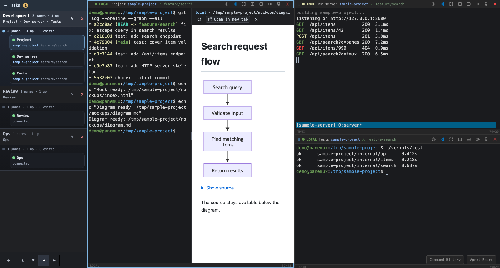

# Workspace UI

Shared design principles, color tokens, modal rules, and layout persistence semantics live in
[UI Overview and Frontend Runtime](overview.md).

## Workspace bar

The workspace bar is always visible, including with one workspace. It contains `← Tasks`
([Task Dashboard](tasks.md)), workspace tabs with summaries and inline rename/delete, `+` to create
a workspace, and bar-position controls.

### Tab position controls

- Top/bottom/left/right buttons use `aria-pressed` on the active position.
- The four direction buttons form one horizontal tab-like cluster, including on left/right bars.
- The position cluster sits on the opposite end from the workspace tabs:
  - Top/bottom bars: tabs stay at the leading side, position controls at the far trailing side.
  - Left/right bars: tabs stay near the top, position controls at the bottom.
- For left/right bars, the bar width is user-resizable by dragging its inner edge. The chosen width
  is shared across workspaces and restored on reload, while the pane layout inside the remaining work
  area keeps its own saved percentage splits.

### Integrated workspace summaries

Each tab shows a one-line count of panes, connected, disconnected, exited, and pending sessions,
plus a compact pane-name strip. Pending means session data has not arrived yet.

### Workspace pane groups

Each workspace renders as a grouped strip anchored to its tab surface. Pane cards are visually and
interactively subordinate to the workspace tab they belong to rather than an independent dashboard
panel:

- Top/bottom bars: pane cards appear as a hover/focus overlay attached to the tab.
- Left/right bars: pane cards stay expanded inline under the tab inside a dedicated scroll region,
  with a fixed footer keeping `+` and all four tab-position buttons visible even when the workspace
  list is taller than the viewport.

Each group shows its workspace title and aggregate counts, then one card per pane: type, connection
state, available repository/branch/PR, attention badges, and a stronger selection treatment for the
focused pane. Clicking a pane card switches to that workspace if needed, focuses the pane, and
clears pane/workspace attention.

Pane cards are also drag sources for cross-workspace moves. Drag starts from the overview card
itself, keeping terminal interaction and layout interaction separate.

## Pane header

### Layout

Left to right: `⠿` drag handle, connection dot, pane type, optional title, optional Git metadata and
PR link, reconnecting text, then right-aligned actions. Chrome uses the shared header palette
([Color palette](overview.md#color-palette)). Repository and `#<number>` PR shortcuts are inline
text links with stronger blue and an underline on hover, without pills or outlines.
[Pane Git and PR metadata](../behavior/pane-metadata.md#pane-git-and-pr-metadata) owns metadata
resolution.

### Multiple worktrees

When the pane's active agent has diverged into one sibling worktree, the header shows that
worktree's repo, branch, and PR shortcut inline. When two or more distinct worktrees are active at
once (such as multiple Claude Task subagents in sibling worktrees), the header shows a single inline
text trigger labeled `<N> worktrees` (for example `2 worktrees`), styled like other inline text
links rather than a pill or badge. Clicking it opens a small popover menu anchored below the header
listing each active worktree as `repo ⎇ branch #<number>` with the same inline-link styling. The
menu closes on `Escape` or clicking outside.

### Split vs quick-add

Split inherits the current pane configuration; quick-add creates a default `local` pane to the right
or below. Both sit at the pane boundary and use monochrome SVG pane-outline icons; quick-add adds a
plus marker to distinguish a fresh context from splitting the current context.

### Drag handle

Pane movement starts only from the `⠿` handle in the header, keeping the terminal body free for
selection, focus, mouse reporting, and shell input. The handle uses `#4a7ea5` and a `grab` cursor,
switching to `grabbing` while dragging.

## Layout editing

### Drag and drop

Drag-and-drop is always available from the pane header handle with no separate edit mode.

- **States**:
  - Normal: full opacity, no move highlight.
  - Drag source: fades and slightly scales down without detaching the live terminal canvas; global
    `grabbing` cursor and a `0.15 s` transition confirm the drag.
  - Pane edge: pointer proximity chooses the nearest edge and shows a translucent blue half-pane
    preview.
  - Divider: retains its resize role normally; a blue overlay during drag advertises insertion.
  - Workspace edge: becomes a drop zone during drag for a new outer split.
- **Interaction model**: workspace edges create outer splits, pane edges insert beside the target,
  and dividers insert relative to the adjacent subtree boundary.
  [Layout operations](overview.md#layout-editing-and-pane-movement) own session and persistence
  semantics.

### Transient error banner

Pane creation and moves are optimistic in the UI and then persisted. When persistence fails:

- The banner appears in the top-right of the workspace content area using a subdued destructive
  palette (`#2f1313`, `#7f1d1d`, `#fca5a5`).
- It includes an explicit dismiss button and stays separate from modal dialog errors because it
  belongs to an in-place interaction rather than a form.
- Create failure and move failure banners stack vertically when both are present.
- It stays hidden until persistence rejects and clears on dismissal or the next create/move attempt.

## Pane URL strip

Opening a URL out of a pane uses one strip pinned to the top of that pane's terminal area (not at
the workspace level, and deliberately not a modal so other panes and surrounding terminal output stay
accessible):

- **Request state**: names the URL and offers `Open` and `Ignore` (plus `Preview` before `Open` and
  `Ignore` for a localhost URL on the panemux host, and reads `This link goes to` instead of
  `This pane wants to open` for a clicked OSC 8 link). It never opens anything on its own.
- **Failure state**: reuses the transient-error palette (`#f4a9a9` on the pane's own surface with a
  `#7f1d1d` edge) and offers `Dismiss`.
- A pending request takes precedence over an older failure so the operator decides one thing at a
  time.
- The URL truncates with an ellipsis and carries the full value as a tooltip so long authorization
  URLs cannot push buttons out of a narrow pane.
- The strip covers the terminal side only (or the whole body when no preview is open), keeping an
  open preview's header visible. The Type in pane popup draws the same strip over its terminal.

## Split preview

A clicked HTML or Markdown path—or a localhost URL—opens beside the terminal rather than over it, in
both workspace panes and the task dashboard's Type in pane popup ([behavior](../behavior/preview.md)).

- The terminal keeps the left side and the preview takes the right, starting at `50:50`. The pane
  header, status bar, and all pane operations stay intact; the split lives in the pane body.
- The preview header shows the host (`local` or the SSH connection name) in accent blue, then the
  absolute path—or, for a relayed localhost URL of an SSH host, the URL as clicked rather than the
  relay's address—truncated with the full value as a tooltip; below it sit `Reload`, an outlined
  `Open in new tab`, and `Close`. Opening larger uses a new tab rather than a preview fullscreen
  mode, so the terminal is never covered.
- While the previewed page has focus, a one-line status note under the header explains that keys go
  to the page and clicking the terminal takes them back (since the sandboxed opaque-origin page
  prevents panemux shortcuts from hearing keys). It is a status rather than an alert and clears as
  soon as focus leaves the page.
- The divider is a `6 px` bar with a centered grip that highlights in accent blue on hover, focus,
  and drag. It is a focusable `separator` moved by arrow keys and reset to `50:50` on double-click.
  Neither side becomes narrower than `160 px`; in a narrow pane the range narrows to match so the
  announced value, key steps, and drawn split agree.
- Loading indicators, refusal reasons, and multi-file choices for relative paths appear inside the
  preview area so the terminal is never covered and keeps taking keys.
- The previewed page uses a white browser-page surface framed by dark panemux chrome.
- Mermaid diagrams in Markdown keep a **Show source** disclosure below each drawing. A failed
  diagram opens its source and shows its error inside that block while the rest of the document
  remains readable. SVG diagrams fit the preview width and scroll when needed.
- For localhost URLs, a one-line note in the same style as the keys note is always shown above the
  page explaining that a page refusing framing stays blank and that hot reload, sign-in, or storage
  can differ in a frame, pointing to `Open in new tab`.

---

